# INF0336 - Seminário

## TrucoON — truco online sobre multicast replicado

### Equipe: ZAP

- 202406913 - André de Oliveira Machado Filho
- 202109882 - Alan Queiroz Dantas de Oliveira
- 202400316 - Stephany Jorge Araújo Resque
- 202103736 - Jamilly Vitorya da Silva Barbosa

## Apresentações

- Checkpoint 1 (05/11): https://docs.google.com/presentation/d/1XnzTkuvcFeIFaiBl8MVHFOCgGdjfAJenacRyqSoGmwE/edit?slide=id.p1#slide=id.p1
- Checkpoint 2 (19/11): https://docs.google.com/presentation/d/18mQT3qAogjV7CZVnszwLlKvBC1TlWlZRCGCNS4gDJNo/edit?usp=sharing

## Resumo

O TrucoON é um truco mineiro online para partidas privadas, pensado para rodar em
vários servidores (um por região), cada um com uma cópia das mesas. Cada jogada é uma
mensagem trocada entre os servidores pela rede, e para todos mostrarem o mesmo jogo
essas mensagens precisam chegar sem se perder e na ordem certa. Reescrevemos o MPComm
em Elixir/Erlang, com um nó de controle que fala com os servidores por socket TCP ou
por RPC e um multicast entre os servidores sobre UDP, com injeção de perda e atraso
para simular regiões diferentes. Sobre o UDP, construímos um canal confiável e FIFO
(número de sequência, ACK cumulativo, retransmissão e fila de espera) e, no
checkpoint 2, transformamos o jogo numa **máquina de estados replicada**: regras puras
e determinísticas (a semente do embaralhamento viaja no comando), uma réplica por
servidor que só aplica um comando depois que ele volta pelo multicast e um único
escritor por servidor. Para mostrar isso ao vivo, construímos um **painel do
multicast** que anima as mensagens indo de um servidor para o outro, paradas nas filas
e chegando à réplica. Esperávamos eliminar perdas e violações de ordem por remetente
em relação ao canal UDP sem tratamento e comparar a latência de socket contra RPC. O
canal confiável zerou perdas, duplicatas e violações de FIFO, e o RPC se mostrou cerca
de 5× mais rápido que o socket por pedido. Com jogadas simultâneas em servidores
diferentes, porém, o FIFO não basta: na disputa de cadeira, **8 de 8 mesas
divergiram**, tanto sem tratamento quanto com FIFO. Conclui-se que o FIFO garante a
ordem de cada remetente, mas não uma ordem igual para todos os servidores, e a ordem
total (Lamport e sequenciador) é o tema do próximo checkpoint.

## Introdução

### Motivação

Jogos online com partidas privadas (1x1 ou 2x2) precisam que todos os participantes
vejam exatamente o mesmo estado de jogo, mesmo quando estão em regiões diferentes. A
forma de conseguir isso é **replicar** o jogo em vários servidores e fazer cada jogada
ser uma **mensagem** trocada entre eles. Num sistema distribuído não há memória
compartilhada: só existe troca de mensagens pela rede [1, 2]. A rede, porém, perde,
duplica, atrasa e reordena mensagens — e cada um desses problemas, num jogo de cartas,
aparece como uma mesa dessincronizada. O TrucoON é o pretexto concreto para estudar,
do geral (processos e troca de mensagens) ao específico (canal confiável e ordenação),
como processos conversam de forma correta.

O trabalho é feito para **Sistemas Operacionais (INF0336)** — UFG, 2026/2. O projeto parte do [MPComm](https://github.com/professorfabio/MPComm)
do Prof. Fábio M. Costa [5], reescrito em **Elixir/Erlang** (com a autorização do
professor). Este README é o **relatório** do trabalho e é atualizado a cada checkpoint.

### Revisão bibliográfica

Do lado de Sistemas Operacionais, Tanenbaum e Bos [1] tratam o processo como a unidade
de isolamento: cada um tem o seu espaço de endereçamento, e a cooperação entre eles se
dá por comunicação entre processos (IPC), seja por memória compartilhada, seja por
troca de mensagens. É também ali que aparecem as condições de corrida e a seção
crítica — o que acontece quando dois processos alteram o mesmo dado sem coordenação — e
as soluções clássicas de exclusão mútua e o problema dos leitores e escritores.

Do lado de Sistemas Distribuídos, Van Steen e Tanenbaum [2] partem da premissa de que
não há memória compartilhada: processos em máquinas diferentes só se comunicam por
mensagens. No capítulo de comunicação, comparam a interface de baixo nível dos sockets
com o RPC, que busca transparência de acesso ao fazer uma chamada remota parecer uma
chamada local. Nos capítulos de coordenação, replicação e tolerância a falhas, mostram
como construir entrega confiável sobre um canal que perde mensagens (números de
sequência, confirmações e retransmissão) e distinguem as garantias de ordem FIFO, causal
e total, além da ideia de que réplicas determinísticas que aplicam os mesmos comandos
na mesma ordem terminam no mesmo estado.

A escolha por Elixir/Erlang se apoia em dois trabalhos sobre a máquina virtual BEAM.
*The BEAM Book* [3] descreve como ela implementa processos leves, cada um com a sua
própria memória e a sua caixa de mensagens, escalonados pela própria máquina virtual,
de modo que o modelo de "processos isolados que só trocam mensagens" vale tanto dentro
de um servidor quanto entre servidores. A tese de Armstrong [4] defende esse mesmo
modelo como base para sistemas confiáveis na presença de erros de software: isolar as
falhas em processos e organizá-los em árvores de supervisão que reiniciam o que quebrou.
Por fim, a base de código reescrita é o MPComm, do Prof. Fábio M. Costa [5], com o nó
de controle, o grupo de peers e o multicast como pontos de partida.

### Objetivos

Construir a base de comunicação do grupo de servidores:

- um **nó de controle** que registra os servidores e coordena experimentos, falando com
  eles por **socket TCP** ou por **RPC**, para comparar os dois transportes;
- um **multicast sobre UDP** entre os servidores, primeiro sem tratamento nenhum e
  depois com um **canal confiável e FIFO**;
- entender e aplicar, sobre esse código, os conceitos de processo, IPC, socket, RPC,
  entrega confiável e ordem FIFO.

No checkpoint 2, sobre essa base:

- transformar o truco numa **máquina de estados replicada**, em que cada jogada é um
  comando multicast aplicado em todas as réplicas;
- garantir **determinismo** (mesmo comando, mesmo resultado em qualquer réplica) e um
  **único escritor** por servidor, sem lock;
- **medir** se as réplicas divergem com jogadas concorrentes sem ordem total;
- **mostrar** o caminho de cada mensagem ao vivo, num painel, para a apresentação.

## Metodologia

### Conjunto de dados (experimentos)

Não há dataset externo: os dados são gerados pelos próprios experimentos, rodados numa
máquina só com injeção de falhas para simular regiões diferentes.

- **Experimento de multicast** (`V.bench(30)`): 4 peers, 30 mensagens por peer, 10% de
  perda (`LOSS=0.1`) e 0–60 ms de atraso por datagrama (`DELAY_MAX=60`), com e sem o
  canal confiável.
- **Experimento de transporte** (`V.transport_benchmark(300)`): 300 pedidos para cada
  um de 3 peers, pelo mesmo caminho de código, variando só o transporte (socket ou RPC).
- **Disputa de cadeira** (`S.seat_race(rooms: 8)`, checkpoint 2): 8 mesas 2x2 com os
  jogadores espalhados por 4 peers, todos pedindo as mesmas cadeiras ao mesmo tempo. No
  fim, o Verifier compara o hash de cada mesa entre as réplicas.

Código de cada entrega: checkpoint 1 na tag `parte-1b`; checkpoint 2 na tag `parte-2`
(aplicação replicada) e na branch `checkpoint-2` (painel ao vivo do multicast). Detalhes
de teoria e prática de cada entrega em
[`docs/checkpoint-1/relatorio.md`](docs/checkpoint-1/relatorio.md) e
[`docs/checkpoint-2/relatorio.md`](docs/checkpoint-2/relatorio.md).

Reproduzir:

```bash
CONTROL=socket ORDERING=none LOSS=0.1 DELAY_MAX=60 scripts/up.sh 4
scripts/run.sh 'V.bench(30)'                  # perdas e violações de FIFO
scripts/down.sh

CONTROL=rpc ORDERING=fifo LOSS=0.1 DELAY_MAX=60 scripts/up.sh 4
scripts/run.sh 'V.bench(30)'                  # 0 perdas, 0 violações
scripts/run.sh 'V.transport_benchmark(300)'   # socket × RPC
scripts/down.sh
```

Checkpoint 2 (jogo replicado e painel):

```bash
scripts/build_web.sh                          # frontend do jogo, servido por cada peer
ORDERING=fifo scripts/up.sh 3
scripts/run.sh 'S.seat_race(rooms: 8)'        # mesas divergentes sem ordem total
# jogo:   http://127.0.0.1:4001
# painel: http://127.0.0.1:4001/painel
scripts/down.sh
```

Testes: `mix test` — `test/truco_on/multicast/protocols_test.exs` (rede simulada com
30% de perda), `test/truco_on/integration/group_test.exs` (blocos "Parte 1a" e
"Parte 1b"), `test/truco_on/truco/` (regras, jogo e mesas) e
`test/truco_on/integration/divergence_test.exs` (réplicas divergem sem ordem total).

### Modelos (stack e infraestrutura)

- **Elixir 1.17 / Erlang-OTP 27** sobre a BEAM: cada peer é um processo do SO
  (`beam.smp`) e, dentro dele, processos leves que só se comunicam por `send`/`receive`
  (`lib/truco_on/peer.ex`).
- **Controle:** `:gen_tcp` com enquadramento `packet: 4` e serialização segura
  (`binary_to_term(_, [:safe])`) no socket (`lib/truco_on/control/socket_server.ex`);
  `:erpc.call` no RPC. Os dois chegam na mesma função `handle/2`
  (`lib/truco_on/control/client.ex`).
- **Multicast:** `:gen_udp` com envio por peer e recepção `active: true`
  (`lib/truco_on/peer/multicast.ex`), com injeção de `LOSS`/`DELAY`.
- **Canal confiável e FIFO:** estrutura pura, sem rede, testada isolada
  (`lib/truco_on/multicast/reliable.ex`): `seq` crescente, retransmissão após 150 ms
  (ou mais, quando o atraso configurado exige, para não retransmitir antes do ACK voltar),
  descarte de duplicatas, fila de espera e ACK cumulativo.
- **Aplicação (checkpoint 2):** regras do truco como funções puras
  (`lib/truco_on/truco/`), a réplica de mesas (`lib/truco_on/peer/replica.ex`, um
  GenServer que é o único escritor, com o estado publicado numa ETS de leitura
  concorrente), REST sem estado com token assinado e WebSocket com um processo por
  jogador (`lib/truco_on_web/`). Frontend em Expo + React Native Web (`app/`).
- **Painel ao vivo (checkpoint 2):** o multicast e a réplica publicam eventos de
  rastreamento (`lib/truco_on/peer/trace.ex`) num canal Phoenix só de leitura; a página
  `/painel` (`priv/painel/`) conecta em todos os peers e anima tudo.
- **Infraestrutura:** sem banco e sem Docker (estado em memória, replicado). Phoenix e
  Bandit vêm pelo `mix`, versões fixadas em `mix.lock`.

**Painel ao vivo do multicast** (`/painel`): mostra os pacotes voando entre os peers, a
fila de espera do canal FIFO, a fila da ordenação e os comandos aplicados em cada
réplica, com o hash encadeado. As jogadas aparecem com nome: "TRUCO!", "SEIS!",
"NOVE!", "DOZE!", "aceita o seis", "corre do nove" e a carta jogada ("joga 4♣ (zap)").
O controle "câmera lenta" aumenta o atraso da rede, "perda de pacotes" descarta
datagramas e o botão "Disputa de cadeira" faz um jogador em cada peer pedir a cadeira
0 ao mesmo tempo. Os controles só funcionam com `PAINEL_CONTROLE=1`, que o
`scripts/up.sh` liga por padrão; num servidor público, o painel fica só de leitura.

### Métricas

- Multicast: mensagens **perdidas**, **duplicadas**, **violações de FIFO** e **posições
  fora de ordem**; custo em **datagramas UDP por multicast**.
- Transporte: latência por pedido (**média**, **mediana**, **p99**).
- Réplicas (checkpoint 2): **mesas divergentes** (hash da mesa diferente entre réplicas)
  e se a **sequência de comandos** aplicada é a mesma (hash encadeado).

### Fluxograma

Fases do projeto (cada parte é construída sobre a anterior):

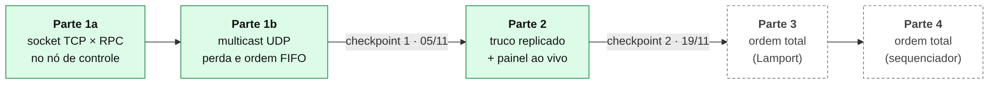

| Parte | Enunciado | Estado |
|---|---|---|
| 1a | Trocar sockets por RPC no cliente-servidor e comparar | ✅ |
| 1b | Perda de mensagens + ordem FIFO no multicast, com sockets | ✅ |
| 2 | Aplicação em que a ordem é crítica (truco replicado) + painel ao vivo | ✅ |
| 3 | Coordenação por ordem total (Lamport, cap. 5) | próximas entregas |
| 4 | Coordenação mais leve (sequenciador, cap. 7) | próximas entregas |

Visão geral da arquitetura (nó de controle + grupo de peers):

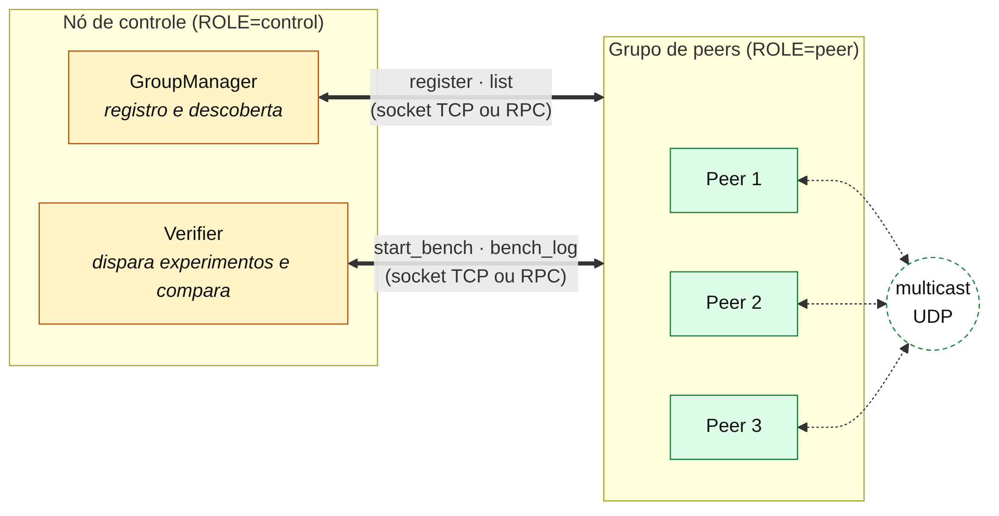

Caminho de uma jogada no checkpoint 2: o servidor não aplica a jogada do próprio
jogador na hora; ele manda para o grupo e só responde depois que o multicast a entrega,
como em todas as outras réplicas.

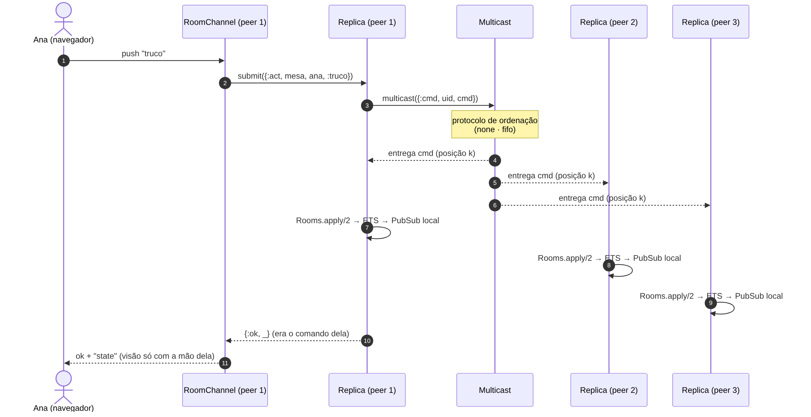

## Resultados

### Gráficos

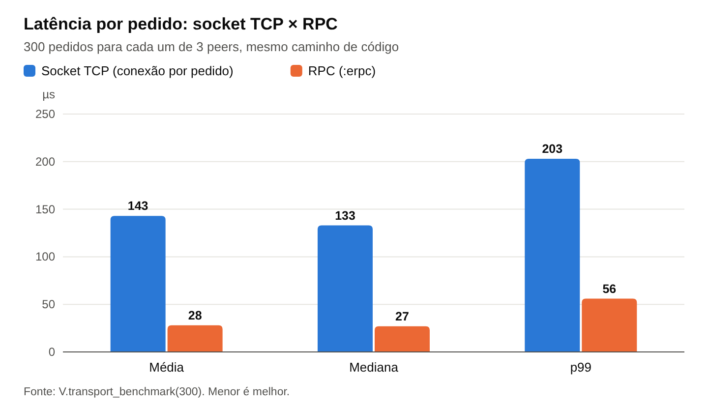

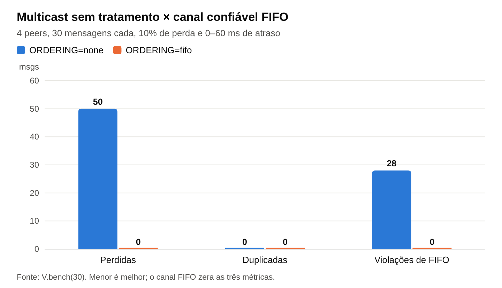

Os gráficos são gerados a partir dos números das tabelas abaixo por
`python3 scripts/graficos.py docs/checkpoint-2/graficos`.

### Tabelas

Multicast — 4 peers, 30 mensagens cada, 10% de perda, 0–60 ms de atraso (`V.bench(30)`):

| `ORDERING` | Perdidas | Duplicadas | Violações FIFO | Posições fora de ordem |
|---|---|---|---|---|
| `none` (sem tratamento) | 50 | 0 | 28 | 110 de 110 |
| `fifo` (canal confiável) | **0** | **0** | **0** | 116 de 120 |

Custo do canal confiável: ~9,3 datagramas UDP por multicast (dados, ACKs e
retransmissões), contra 4 no modo sem tratamento.

Transporte — 300 pedidos para cada um de 3 peers (`V.transport_benchmark(300)`):

| Transporte | Média | Mediana | p99 |
|---|---|---|---|
| Socket TCP (uma conexão por pedido) | 143 µs | 133 µs | 203 µs |
| RPC (`:erpc`) | 28 µs | 27 µs | 56 µs |

Réplicas — disputa de cadeira, 8 mesas 2x2, 4 peers (`S.seat_race(rooms: 8)`):

| `ORDERING` | Mesas divergentes |
|---|---|
| `none` (sem tratamento) | 8 de 8 |
| `fifo` (canal confiável) | 8 de 8 |

### Multimídia (painel e diagramas)

Painel ao vivo do multicast durante uma partida (modo `fifo`, câmera lenta em 1600 ms):
cada coluna é um servidor, e cada jogada desce pelas camadas ① rede, ② canal FIFO,
③ ordenação e ④ réplica. O hash encadeado com a mesma cor nas três colunas indica que
as réplicas aplicaram a mesma sequência.

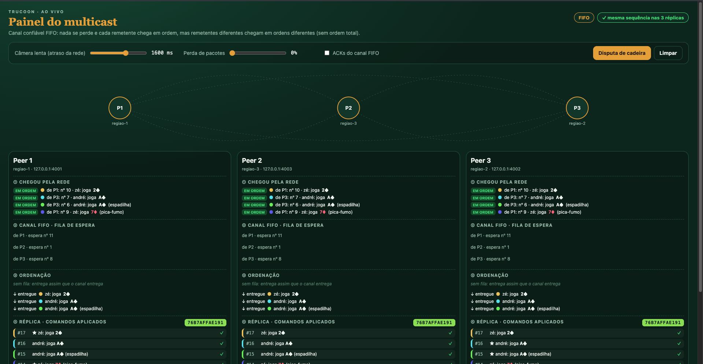

A mesma tela na disputa de cadeira: P1, P2 e P3 pedem a cadeira 0 ao mesmo tempo, cada
um por um servidor. Sem ordem total, a réplica do Peer 1 deu a cadeira para P1 e as
outras duas para P3; os hashes encadeados ficaram com cores diferentes.

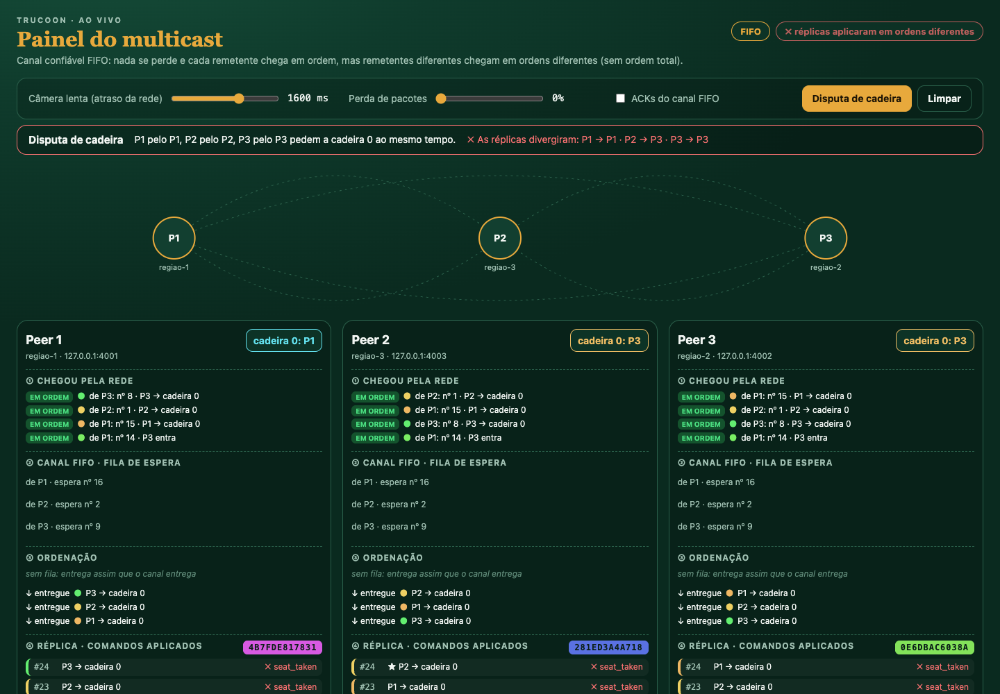

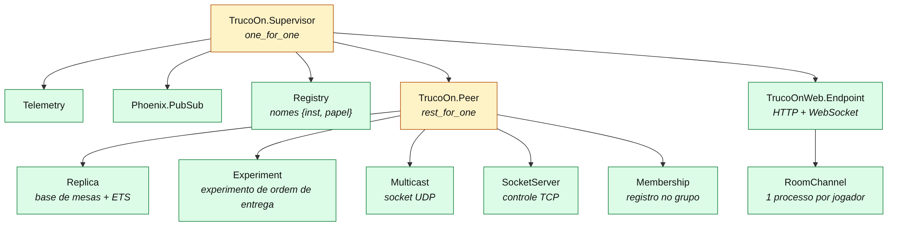

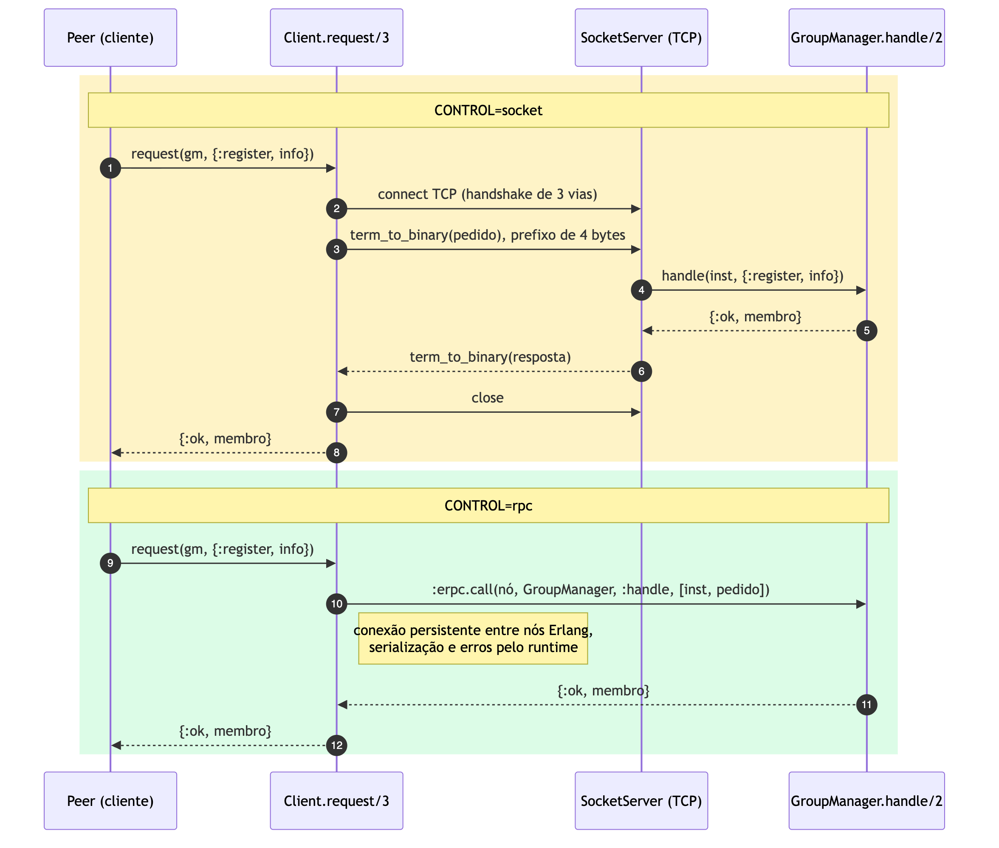

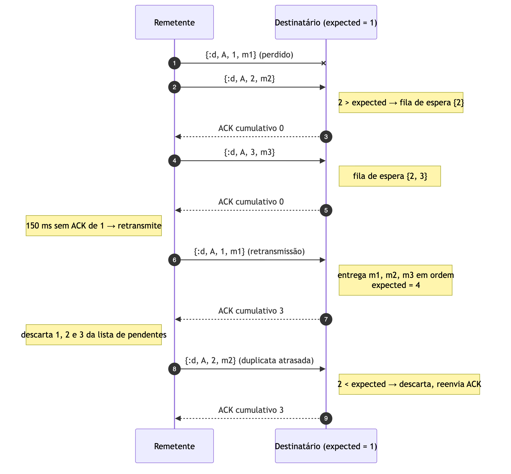

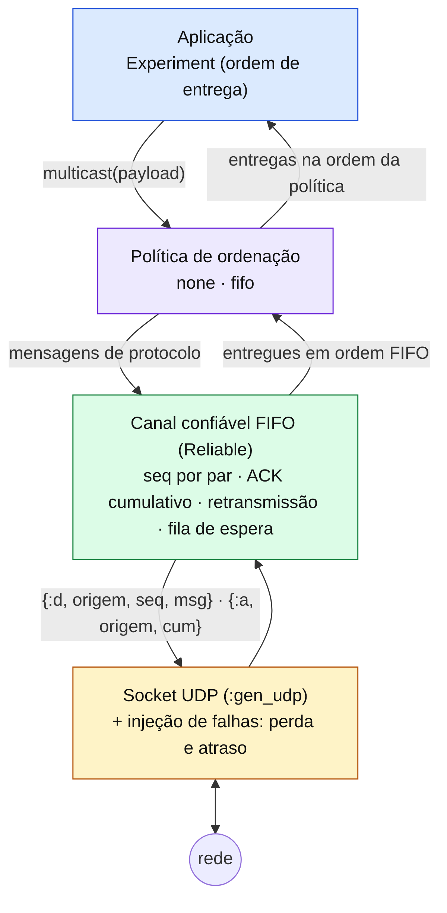

## Discussão

- **Socket × RPC** [2, cap. 4]: o RPC esconde a rede atrás de uma chamada de função e
  ganha em latência (~5×) porque o Erlang mantém a conexão TCP aberta entre nós,
  enquanto o socket faz o handshake de 3 vias a cada pedido. Em troca, o RPC acopla as
  duas pontas à plataforma (nós Erlang com o mesmo *cookie*, portas do epmd) e expõe
  qualquer função ao remoto; o socket é independente de linguagem e expõe só o que
  `handle/2` aceita. Na prática, o navegador do jogador não fala RPC do Erlang — por
  isso o acoplamento de plataforma é uma restrição real.
- **Entrega confiável e FIFO** [2, cap. 8]: número de sequência, ACK cumulativo,
  retransmissão e fila de espera eliminam perdas, duplicatas e violações de ordem por
  remetente, ao custo de mais datagramas por mensagem — o preço esperado da
  confiabilidade sobre um canal não confiável.
- **Limite do FIFO:** o FIFO ordena as mensagens *de cada remetente*, mas não impõe uma
  ordem igual para todos os servidores: mensagens de remetentes diferentes ainda chegam
  em ordens diferentes (116 de 120 posições fora de ordem mesmo com FIFO). Garantir uma
  ordem única para todos é o problema de ordem total.
- **Máquina de estados replicada** [2, cap. 7] (checkpoint 2): se todas as réplicas
  começam iguais e aplicam os mesmos comandos na mesma ordem, terminam iguais. Por isso
  as regras são puras e a semente do embaralhamento viaja no comando: sem relógio local
  nem timers, a única fonte de diferença entre réplicas passa a ser a ordem.
- **Condição de corrida entre réplicas** [1, cap. 2], [2, cap. 7]: o mesmo problema da
  seção crítica de SO, agora entre servidores. Dois jogadores pedem a mesma cadeira por
  servidores diferentes, e cada réplica dá a cadeira para quem chegou primeiro nela. O
  FIFO não impede isso (8 de 8 mesas divergiram), e o painel mostra o momento exato em
  que as réplicas se separam. O mesmo vale para truco × carta e aceito × corro.
- **Um único escritor** [1, cap. 2], [3]: a réplica é um GenServer que processa uma
  mensagem por vez, então não precisa de lock; os jogadores leem da ETS sem entrar na
  fila (leitores e escritores). A árvore de supervisão (`rest_for_one`) e um processo
  por jogador isolam falhas [4].

## Conclusão

**Checkpoint 1.** Os objetivos foram alcançados: socket e RPC resolvem a mesma comunicação
cliente-servidor, com o RPC entregando menos código e melhor tratamento de erros e o
socket entregando independência de plataforma e controle sobre o que é exposto; e o
canal confiável zerou perdas, duplicatas e violações de FIFO, pagando com mais
datagramas por mensagem. Ficou também evidente o limite do FIFO: ele garante a ordem de
cada remetente, mas não uma ordem igual para todos os servidores.

**Checkpoint 2.** O truco virou uma máquina de estados replicada: regras
determinísticas, um único escritor por servidor e os mesmos comandos em cada réplica.
Enquanto as jogadas não são concorrentes, as réplicas ficam iguais; quando duas jogadas
acontecem ao mesmo tempo em servidores diferentes, cada cópia decide de um jeito, e o
FIFO não impede isso (8 de 8 mesas divergentes). O painel ao vivo torna isso visível
na apresentação, mensagem por mensagem. Próximo passo: ordem total com relógios de
Lamport (Parte 3) e com sequenciador (Parte 4), em que a disputa de cadeira passa a ter
o mesmo vencedor em todas as réplicas.

## Referências

- [1] TANENBAUM, A. S.; BOS, H. **Sistemas operacionais modernos**. 4. ed. São Paulo:
  Pearson, 2016.
- [2] VAN STEEN, M.; TANENBAUM, A. S. **Distributed systems**. 4. ed. [S.l.]:
  distributed-systems.net, 2023.
- [3] STENMAN, E. **The BEAM book**: understanding the Erlang runtime system. [S.l.:
  s.n.], [s.d.]. Disponível em: https://blog.stenmans.org/theBeamBook/. Acesso em:
  5 nov. 2026.
- [4] ARMSTRONG, J. **Making reliable distributed systems in the presence of software
  errors**. 2003. Tese (Doutorado) — KTH Royal Institute of Technology, Estocolmo, 2003.
- [5] COSTA, F. M. **MPComm**. GitHub, [s.d.]. Disponível em:
  https://github.com/professorfabio/MPComm. Acesso em: 5 nov. 2026.
