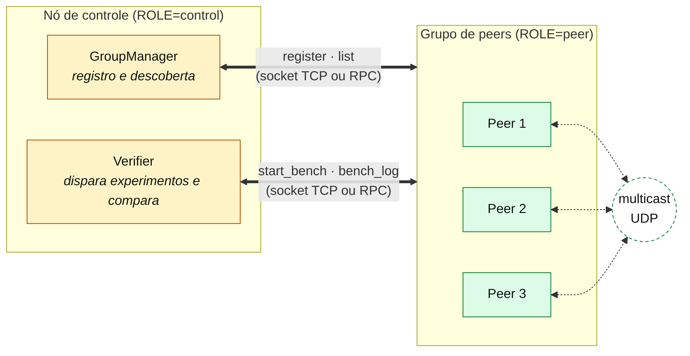
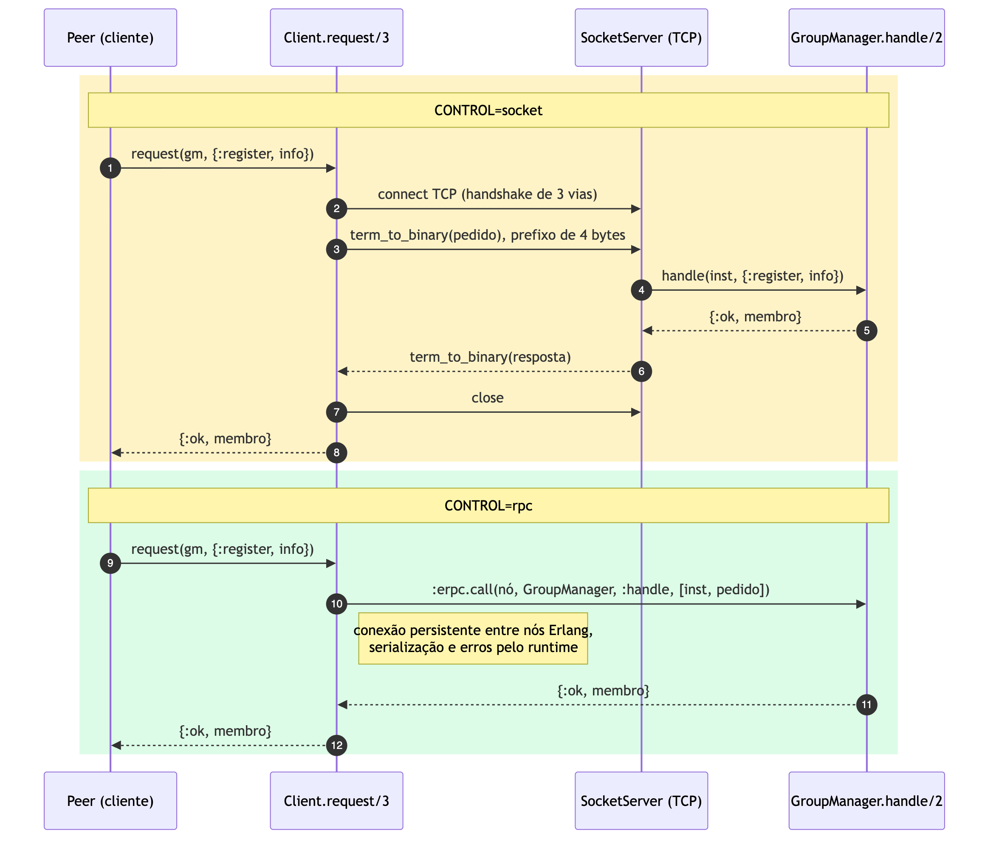
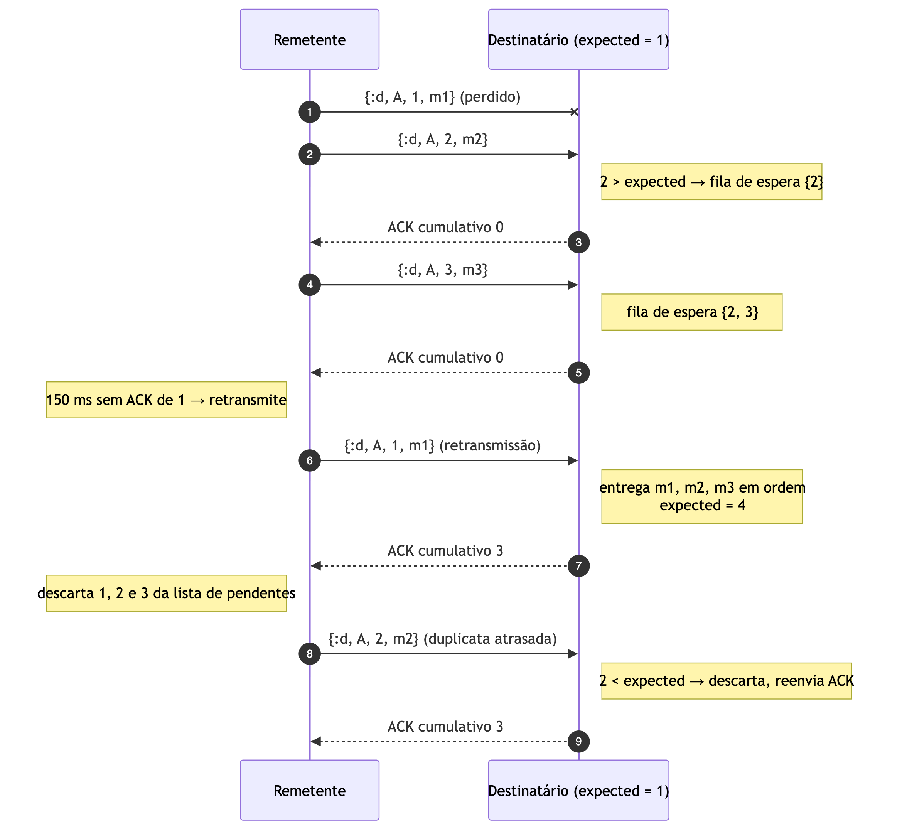
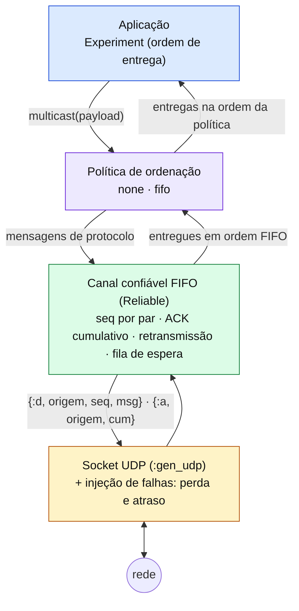

# INF0336 — Seminário

## TrucoON — truco online sobre multicast replicado

Trabalho de **Sistemas Operacionais** e **Sistemas Distribuídos (INF0344)** — UFG,
2026/2. O projeto parte do [MPComm](https://github.com/professorfabio/MPComm) do Prof.
Fábio M. Costa, reescrito em **Elixir/Erlang** (com a autorização do professor).
Código deste checkpoint: tag `parte-1b`.

## Equipe

Equipe **ZAP**:

- 202406913 — André de Oliveira Machado Filho
- 202109882 — Alan Queiroz Dantas de Oliveira
- 202400316 — Stephany Jorge Araújo Resque
- 202103736 — Jamilly Vitorya da Silva Barbosa

## Apresentações

- Checkpoint 1 (05/11): https://docs.google.com/presentation/d/1XnzTkuvcFeIFaiBl8MVHFOCgGdjfAJenacRyqSoGmwE/edit?slide=id.p1#slide=id.p1

## Resumo

O TrucoON é um truco mineiro online para partidas privadas, pensado para rodar em
vários servidores (um por região), cada um com uma cópia das mesas. Cada jogada é uma
mensagem trocada entre os servidores pela rede, e para todos mostrarem o mesmo jogo
essas mensagens precisam chegar sem se perder e na ordem certa. Reescrevemos o MPComm
em Elixir/Erlang, com um nó de controle que fala com os servidores por socket TCP ou
por RPC e um multicast entre os servidores sobre UDP. Sobre o UDP, construímos um canal
confiável e FIFO (número de sequência, ACK cumulativo, retransmissão e fila de espera),
com injeção de perda e atraso para simular regiões diferentes. Esperávamos eliminar
perdas e violações de ordem por remetente em relação ao canal UDP sem tratamento e
comparar a latência de socket contra RPC. O canal confiável zerou perdas, duplicatas e
violações de FIFO, e o RPC se mostrou cerca de 5× mais rápido que o socket por pedido.
Conclui-se que o FIFO garante a ordem de cada remetente, mas não uma ordem igual para
todos os servidores — problema que os próximos checkpoints resolvem.

## Introdução

### Motivação

Jogos online com partidas privadas (1x1 ou 2x2) precisam que todos os participantes
vejam exatamente o mesmo estado de jogo, mesmo quando estão em regiões diferentes. A
forma de conseguir isso é **replicar** o jogo em vários servidores e fazer cada jogada
ser uma **mensagem** trocada entre eles. Num sistema distribuído não há memória
compartilhada: só existe troca de mensagens pela rede [1, 2]. A rede, porém, perde,
duplica, atrasa e reordena mensagens — e cada um desses problemas, num jogo de cartas,
aparece como uma mesa dessincronizada. O TrucoON é o pretexto concreto para estudar,
do geral (processos e troca de mensagens) ao específico (canal confiável e ordenação),
como processos conversam de forma correta.

### Revisão bibliográfica

- Processos, IPC, sockets e RPC: Tanenbaum & Bos [1] (lado SO) e Van Steen & Tanenbaum
  [2] (lado SD, capítulo de comunicação).
- Confiabilidade sobre canal não confiável e ordenação de mensagens: Van Steen &
  Tanenbaum [2].
- Modelo de processos isolados que só se comunicam por mensagens, base da escolha por
  Elixir/Erlang: *The BEAM Book* [3] e a tese de Armstrong [4].
- Base de código reescrita: MPComm, do Prof. Fábio M. Costa [5].

### Objetivos

Construir a base de comunicação do grupo de servidores:

- um **nó de controle** que registra os servidores e coordena experimentos, falando com
  eles por **socket TCP** ou por **RPC**, para comparar os dois transportes;
- um **multicast sobre UDP** entre os servidores, primeiro sem tratamento nenhum e
  depois com um **canal confiável e FIFO**;
- entender e aplicar, sobre esse código, os conceitos de processo, IPC, socket, RPC,
  entrega confiável e ordem FIFO.

## Metodologia

### Conjunto de dados (experimentos)

Não há dataset externo: os dados são gerados pelos próprios experimentos, rodados numa
máquina só com injeção de falhas para simular regiões diferentes.

- **Experimento de multicast** (`V.bench(30)`): 4 peers, 30 mensagens por peer, 10% de
  perda (`LOSS=0.1`) e 0–60 ms de atraso por datagrama (`DELAY_MAX=60`), com e sem o
  canal confiável.
- **Experimento de transporte** (`V.transport_benchmark(300)`): 300 pedidos para cada
  um de 3 peers, pelo mesmo caminho de código, variando só o transporte (socket ou RPC).

### Modelos (stack e infraestrutura)

- **Elixir 1.17 / Erlang-OTP 27** sobre a BEAM: cada peer é um processo do SO
  (`beam.smp`) e, dentro dele, processos leves que só se comunicam por `send`/`receive`
  (`lib/truco_on/peer.ex`).
- **Controle:** `:gen_tcp` com enquadramento `packet: 4` e serialização segura
  (`binary_to_term(_, [:safe])`) no socket (`lib/truco_on/control/socket_server.ex`);
  `:erpc.call` no RPC. Os dois chegam na mesma função `handle/2`
  (`lib/truco_on/control/client.ex`).
- **Multicast:** `:gen_udp` com envio por peer e recepção `active: true`
  (`lib/truco_on/peer/multicast.ex`), com injeção de `LOSS`/`DELAY`.
- **Canal confiável e FIFO:** estrutura pura, sem rede, testada isolada
  (`lib/truco_on/multicast/reliable.ex`): `seq` crescente, retransmissão após 150 ms,
  descarte de duplicatas, fila de espera e ACK cumulativo.
- **Infraestrutura:** sem banco e sem Docker (estado em memória, replicado). Phoenix e
  Bandit vêm pelo `mix`, versões fixadas em `mix.lock`.

Reproduzir:

```bash
CONTROL=socket ORDERING=none LOSS=0.1 DELAY_MAX=60 scripts/up.sh 4
scripts/run.sh 'V.bench(30)'                  # perdas e violações de FIFO
scripts/down.sh

CONTROL=rpc ORDERING=fifo LOSS=0.1 DELAY_MAX=60 scripts/up.sh 4
scripts/run.sh 'V.bench(30)'                  # 0 perdas, 0 violações
scripts/run.sh 'V.transport_benchmark(300)'   # socket × RPC
scripts/down.sh
```

Testes: `mix test` — `test/truco_on/multicast/protocols_test.exs` (rede simulada com
30% de perda) e `test/truco_on/integration/group_test.exs` (blocos "Parte 1a" e
"Parte 1b").

### Métricas

- Multicast: mensagens **perdidas**, **duplicadas**, **violações de FIFO** e **posições
  fora de ordem**; custo em **datagramas UDP por multicast**.
- Transporte: latência por pedido (**média**, **mediana**, **p99**).

### Fluxograma

Fases do projeto e visão geral da arquitetura (nó de controle + grupo de peers):

| Parte | Enunciado | Estado |
|---|---|---|
| 1a | Trocar sockets por RPC no cliente-servidor e comparar | ✅ |
| 1b | Perda de mensagens + ordem FIFO no multicast, com sockets | ✅ |
| 2 | Aplicação em que a ordem é crítica (truco replicado) | próximas entregas |
| 3 | Coordenação por ordem total (Lamport, cap. 5) | próximas entregas |
| 4 | Coordenação mais leve (sequenciador, cap. 7) | próximas entregas |



## Resultados

### Tabelas

Multicast — 4 peers, 30 mensagens cada, 10% de perda, 0–60 ms de atraso (`V.bench(30)`):

| `ORDERING` | Perdidas | Duplicadas | Violações FIFO | Posições fora de ordem |
|---|---|---|---|---|
| `none` (sem tratamento) | 50 | 0 | 28 | 110 de 110 |
| `fifo` (canal confiável) | **0** | **0** | **0** | 116 de 120 |

Custo do canal confiável: ~9,3 datagramas UDP por multicast (dados, ACKs e
retransmissões), contra 4 no modo sem tratamento.

Transporte — 300 pedidos para cada um de 3 peers (`V.transport_benchmark(300)`):

| Transporte | Média | Mediana | p99 |
|---|---|---|---|
| Socket TCP (uma conexão por pedido) | 143 µs | 133 µs | 203 µs |
| RPC (`:erpc`) | 28 µs | 27 µs | 56 µs |

### Multimídia (diagramas)







## Discussão

- **Socket × RPC** [2, cap. 4]: o RPC esconde a rede atrás de uma chamada de função e
  ganha em latência (~5×) porque o Erlang mantém a conexão TCP aberta entre nós,
  enquanto o socket faz o handshake de 3 vias a cada pedido. Em troca, o RPC acopla as
  duas pontas à plataforma (nós Erlang com o mesmo *cookie*, portas do epmd) e expõe
  qualquer função ao remoto; o socket é independente de linguagem e expõe só o que
  `handle/2` aceita. Na prática, o navegador do jogador não fala RPC do Erlang — por
  isso o acoplamento de plataforma é uma restrição real.
- **Entrega confiável e FIFO** [2, cap. 8]: número de sequência, ACK cumulativo,
  retransmissão e fila de espera eliminam perdas, duplicatas e violações de ordem por
  remetente, ao custo de mais datagramas por mensagem — o preço esperado da
  confiabilidade sobre um canal não confiável.
- **Limite do FIFO:** o FIFO ordena as mensagens *de cada remetente*, mas não impõe uma
  ordem igual para todos os servidores: mensagens de remetentes diferentes ainda chegam
  em ordens diferentes (116 de 120 posições fora de ordem mesmo com FIFO). Garantir uma
  ordem única para todos é o problema de ordem total, abordado nos próximos checkpoints.

## Conclusão

Os objetivos do checkpoint foram alcançados: socket e RPC resolvem a mesma comunicação
cliente-servidor, com o RPC entregando menos código e melhor tratamento de erros e o
socket entregando independência de plataforma e controle sobre o que é exposto; e o
canal confiável zerou perdas, duplicatas e violações de FIFO, pagando com mais
datagramas por mensagem. Ficou também evidente o limite do FIFO: ele garante a ordem de
cada remetente, mas não uma ordem igual para todos os servidores — ponto de partida das
Partes 3 e 4 (ordem total e coordenação mais leve).

## Referências

- [1] TANENBAUM, A. S.; BOS, H. **Sistemas Operacionais Modernos**. 4. ed. São Paulo:
  Pearson, 2016.
- [2] VAN STEEN, M.; TANENBAUM, A. S. **Distributed Systems**. 4. ed. [S.l.]:
  distributed-systems.net, 2023.
- [3] STENMAN, E. **The BEAM Book: Understanding the Erlang Runtime System**.
  Disponível em: https://blog.stenmans.org/theBeamBook/. Acesso em: 5 nov. 2026.
- [4] ARMSTRONG, J. **Making reliable distributed systems in the presence of software
  errors**. 2003. Tese (Doutorado) — KTH Royal Institute of Technology, Estocolmo, 2003.
- [5] COSTA, F. M. **MPComm**. GitHub, [s.d.]. Disponível em:
  https://github.com/professorfabio/MPComm. Acesso em: 5 nov. 2026.
