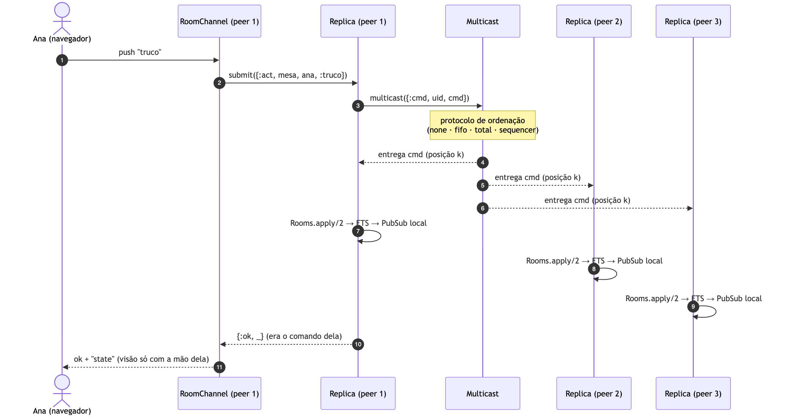
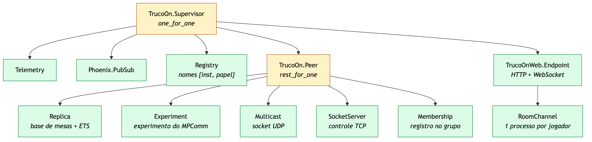

# Diagramas do TrucoON
## perguntar para o professor :
- O truco online  replicado serve como aplicação da Parte 2, com a ordem das mensagens como critério crítico?
- Podemos reescrever o MPComm em Elixir/OTP do erlang, com a mesma arquitetura, em vez de partir do código em Python?
- vamos apresentar só em video para o senhor né ? ao Simular regiões numa máquina, com perda e atraso injetados, basta? Ou devemos rodar em máquinas separadas na nuvem?
Todos os diagramas para apresentação. Cada um existe em três formatos em
`docs/diagramas/`:

- `.mmd`: fonte em Mermaid, para editar;
- `.svg`: vetorial, para slides que aceitam SVG;
- `.png`: 3× de resolução, fundo branco, para qualquer ferramenta de slides.

Para gerar de novo depois de editar um `.mmd`: `scripts/render_diagrams.sh`.

| Diagrama | Arquivo | Sugestão de slide |
|---|---|---|
| Visão geral (controle + peers) | `1a-visao-geral` | o ponto de partida: o MPComm reorganizado |
| Socket × RPC | `1a-socket-vs-rpc` | Parte 1a |
| Perda e retransmissão | `1b-perda-retransmissao` | Parte 1b: como o canal confiável funciona |
| Camadas de um peer | `1b-camadas-peer` | onde cada parte do trabalho se encaixa |
| Arquitetura completa | `2-arquitetura` | slide de arquitetura da aplicação |
| Caminho de uma jogada | `2-fluxo-comando` | Parte 2: replicação por máquina de estados |
| Divergência na disputa de cadeira | `2-divergencia` | Parte 2: por que a ordem é crítica |
| Árvore de supervisão | `2-supervisao` | processos com e sem estado, tolerância a falhas do OTP |
| Lamport | `3-lamport` | Parte 3 |
| Sequenciador | `4-sequenciador` | Parte 4 |
| Custo × tamanho do grupo | `4-custo` | comparação final 3 × 4 |

## Visão geral

## Socket × RPC (Parte 1a)

## Canal confiável FIFO (Parte 1b)

## Camadas de um peer

## Arquitetura da aplicação (Parte 2)

## Caminho de uma jogada

## Divergência sem ordem total

## Supervisão OTP

## Lamport (Parte 3)

## Sequenciador (Parte 4)

## Custo em mensagens

## Resultados medidos

4 peers, 10% de perda, 0–60 ms de atraso, 30 mensagens por peer:

| Modo | Perdidas | Fora de ordem | Mesas divergentes | Msgs/multicast |
|---|---|---|---|---|
| none | 50 | 110/110 | 8/8 | 4 |
| fifo | 0 | 116/120 | 8/8 | 4 |
| total (Lamport) | 0 | 0/120 | 0/8 | 20 |
| sequencer | 0 | 0/120 | 0/8 | 4,75 |
