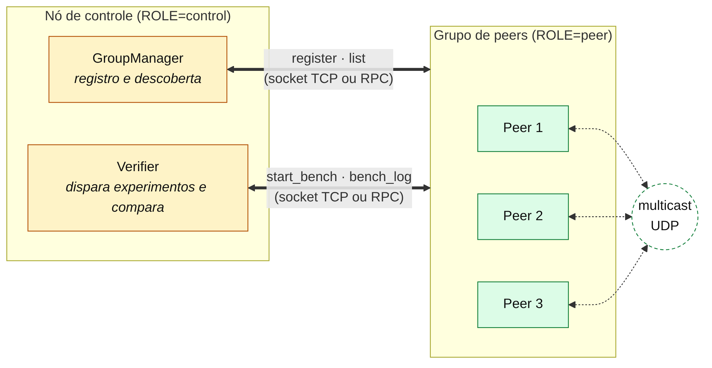
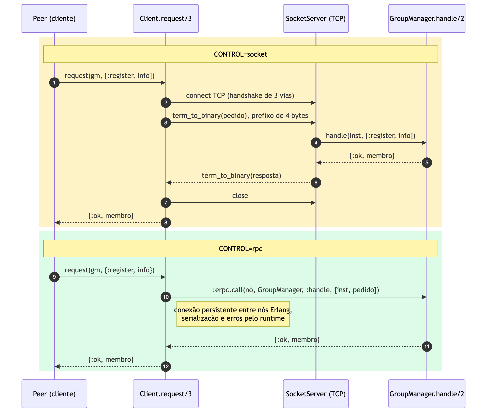
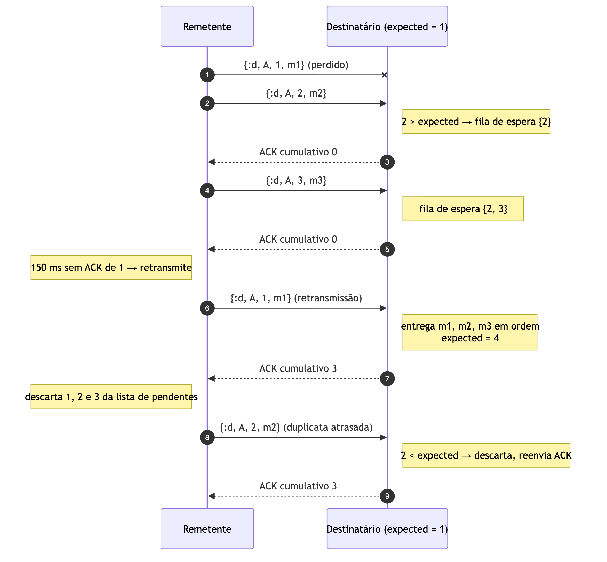
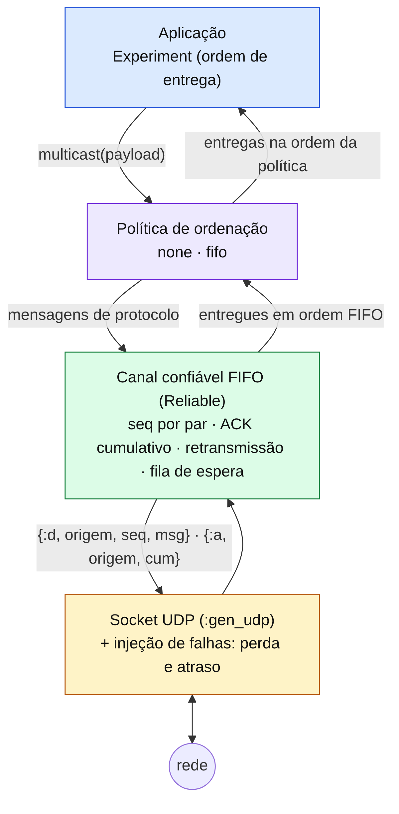

# Checkpoint 1 (05/11): como processos conversam

**Disciplinas:** Sistemas Operacionais e Sistemas Distribuídos (INF0344), UFG, 2026/2
**Equipe:** ZAP
**Participantes:**
- André de Oliveira Machado Filho (202406913)
- Alan Queiroz Dantas de Oliveira (202109882)
- Stephany Jorge Araújo Resque (202400316)
- Jamilly Vitorya da Silva Barbosa (202103736)

**Código deste checkpoint:** tag `parte-1b`

Cada tópico segue a mesma estrutura:

- **Teoria:** o conceito como é visto em aula (SO e SD);
- **Na implementação:** como o conceito aparece no código, com os arquivos;
- **No jogo:** qual papel ele tem no truco online.

---

## 1. Contexto: o que é o TrucoON

Primeira apresentação para a turma, então esta seção explica o projeto antes de entrar
nos tópicos.

- **O jogo:** truco mineiro online para partidas privadas (1x1 ou 2x2). Uma pessoa
  cria a mesa, manda o link ou o QR code para os amigos e eles jogam pelo navegador.
- **A ideia:** o jogo roda em vários **servidores**, um por região, e cada um guarda
  uma cópia das mesas. Os servidores formam um grupo de processos que troca mensagens
  pela rede, e cada mensagem é uma **jogada**. Para todos os servidores mostrarem o
  mesmo jogo, essas mensagens precisam chegar sem se perder e na ordem certa.
- **Por que Elixir/Erlang:** a máquina virtual do Erlang (BEAM) foi feita para
  processos isolados que só se comunicam por mensagens [3, 4]. É o mesmo modelo do
  trabalho, aplicado dentro de cada máquina e entre máquinas.
- **Objetivo deste checkpoint:** construir a base de comunicação do grupo:
  - um **nó de controle** que registra os servidores e coordena experimentos, falando
    com eles por **socket TCP** ou por **RPC**;
  - um **multicast sobre UDP** entre os servidores, primeiro sem tratamento nenhum e
    depois com um **canal confiável e FIFO**.



## 2. Processos e troca de mensagens

**Teoria.** [1, cap. 2], [3], [4]
- SO: processo, espaço de endereçamento, estados (pronto, executando, bloqueado),
  comunicação entre processos (IPC) por memória compartilhada ou por troca de mensagens.
- SD: num sistema distribuído não existe memória compartilhada; só existe troca de
  mensagens pela rede.
- Espera ativa (um laço testando uma condição) × bloqueio: o processo bloqueado sai da
  fila de prontos e não gasta CPU.

**Na implementação.**
- Cada peer é **um processo do SO** (`beam.smp`). Dentro dele, a BEAM roda processos
  leves, cada um com seu heap, que só se comunicam por `send`/`receive`.
- Nenhum processo fica em espera ativa. Quem espera uma mensagem fica bloqueado no
  `receive`; quem precisa esperar um tempo usa timers (`Process.send_after`).
- Árvore de processos do peer: `lib/truco_on/peer.ex` (supervisor).

**No jogo.**
- Cada servidor de jogo é um processo do SO, e dentro dele cada tarefa (rede, controle,
  registro no grupo) é um processo leve. O modelo de "processos que só trocam
  mensagens" vale dentro da máquina e entre as máquinas.

## 3. Modelo cliente-servidor com sockets TCP

**Teoria.** [1], [2, cap. 4]
- Socket como ponto de comunicação do SO: `socket`, `bind`, `listen`, `accept`,
  `connect`, `send`/`recv`. As chamadas de sistema passam pelos buffers do kernel.
- TCP é um fluxo de bytes: quem programa precisa delimitar as mensagens
  (enquadramento) e serializar os dados.
- E/S bloqueante × orientada a eventos.

**Na implementação.**
- `lib/truco_on/control/socket_server.ex`: `:gen_tcp.listen` com `packet: 4`
  (prefixo de 4 bytes com o tamanho de cada mensagem) e `active: false` (o processo
  chama `recv` e bloqueia). Sem o prefixo, uma leitura de tamanho fixo pode truncar
  mensagens grandes.
- Serialização com `:erlang.term_to_binary/1`. Na leitura,
  `binary_to_term(bin, [:safe])`, que recusa termos que criariam átomos novos ou
  referências a funções. Desserializar dados da rede sem esse cuidado pode permitir
  executar código remoto.
- Pedido desconhecido recebe uma resposta de erro, em vez de deixar o cliente
  esperando para sempre.

**No jogo.**
- O **nó de controle** (`GroupManager`) é o servidor onde os servidores de jogo se
  registram e descobrem os outros. Sem ele, um servidor não sabe para quem mandar as
  jogadas.

## 4. RPC: chamada de procedimento remoto

**Teoria.** [2, cap. 4]
- RPC esconde a rede atrás de uma chamada de função: stubs, empacotamento dos
  parâmetros (*marshalling*) e transparência de acesso.
- Uma chamada remota pode falhar de formas que uma chamada local não falha: rede fora,
  servidor caído, timeout.

**Na implementação.**
- `lib/truco_on/control/client.ex`: o mesmo pedido sai por socket ou por RPC
  (`:erpc.call`), conforme a variável `CONTROL`.
- Os dois transportes chegam **na mesma função** `handle/2` no servidor, então a
  comparação é justa: só o transporte muda.
- Medição (`V.transport_benchmark(300)`, 300 pedidos para cada um de 3 peers):

| Transporte | Média | Mediana | p99 |
|---|---|---|---|
| Socket TCP (uma conexão por pedido) | 143 µs | 133 µs | 203 µs |
| RPC (`:erpc`) | 28 µs | 27 µs | 56 µs |

- O RPC ganha porque o Erlang mantém uma conexão TCP aberta entre os nós; o socket
  abre e fecha uma conexão (handshake de 3 vias) a cada pedido.

| | RPC | Socket |
|---|---|---|
| Código | chamada parece local; o runtime cuida de conexão, serialização e erros | conexão, enquadramento e serialização feitos à mão |
| Erros | exceção, timeout e nó fora do ar voltam como erro para quem chamou | é preciso tratar cada caso no código |
| Plataforma | os dois lados precisam ser nós Erlang com o mesmo *cookie* | funciona entre quaisquer linguagens |
| Segurança | quem tem o cookie executa **qualquer** função no nó remoto | expõe só o que `handle/2` aceita |
| Implantação | exige a porta 4369 (epmd) e uma faixa de portas abertas | uma porta por serviço |



**No jogo.**
- O nó de controle usa RPC (ou socket) para comandar os servidores de jogo: iniciar
  experimentos, coletar resultados, mudar a perda de pacotes em tempo real.
- O navegador do jogador não fala RPC do Erlang, então o jogador precisa de outro
  protocolo (HTTP e WebSocket). É o "acoplamento de plataforma" do RPC na prática.

## 5. Multicast sobre UDP: perda, atraso e reordenação

**Teoria.** [2, cap. 4]
- UDP entrega datagramas sem garantia: podem se perder, chegar duplicados ou fora de
  ordem.
- Multicast em nível de aplicação: enviar a mesma mensagem para N processos com N
  envios.

**Na implementação.**
- `lib/truco_on/peer/multicast.ex`: envio com `:gen_udp.send/3` para cada peer;
  recepção em modo `active: true` (o datagrama vira uma mensagem na caixa do processo,
  parecido com uma interrupção).
- **Injeção de falhas** para simular regiões diferentes numa máquina só: `LOSS`
  (probabilidade de descarte) e `DELAY_MIN`/`DELAY_MAX` (atraso aleatório, que causa
  reordenação). Muda em tempo real com `V.faults/3`.
- `ORDERING=none`: entrega o que chegar, na ordem em que chegar, sem tratamento.

**No jogo.**
- Cada jogada é enviada para todos os servidores. Uma jogada perdida deixa uma cópia
  das mesas desatualizada: o jogador ligado àquele servidor nunca vê a carta jogada.

## 6. Canal confiável e ordem FIFO

**Teoria.** [2, cap. 8]
- Confiabilidade sobre um canal não confiável: número de sequência, confirmação (ACK),
  retransmissão por tempo esgotado.
- ACK cumulativo ("recebi tudo até n") e fila de espera (*hold-back queue*) para
  mensagens que chegam adiantadas.
- **Ordem FIFO:** as mensagens de um mesmo remetente são entregues na ordem em que ele
  enviou.

**Na implementação.**
- `lib/truco_on/multicast/reliable.ex`: estrutura de dados pura, sem rede, testada
  sozinha. Um canal por par (remetente → destinatário):
  - remetente: `seq` crescente, guarda o que não teve ACK e retransmite após 150 ms;
  - destinatário: `expected`, descarta duplicatas, guarda as adiantadas, entrega as
    contíguas e responde com ACK cumulativo.
- Formato dos datagramas: `{:d, origem, seq, msg}`, `{:a, origem, cum}`,
  `{:r, origem, msg}`.





**No jogo.**
- As jogadas de um mesmo jogador chegam na ordem certa em todos os servidores: se ele
  pede truco e depois joga uma carta, ninguém vê a carta antes do truco.

## 7. Resultados

4 peers, 30 mensagens cada, 10% de perda, 0–60 ms de atraso (`V.bench(30)`):

| `ORDERING` | Perdidas | Duplicadas | Violações FIFO | Posições fora de ordem |
|---|---|---|---|---|
| `none` (sem tratamento) | 50 | 0 | 28 | 110 de 110 |
| `fifo` (canal confiável) | **0** | **0** | **0** | 116 de 120 |

Custo do canal confiável: ~9,3 datagramas UDP por multicast (dados, ACKs e
retransmissões), contra 4 no modo sem tratamento.

## 8. Demonstração prática

```bash
CONTROL=socket ORDERING=none LOSS=0.1 DELAY_MAX=60 scripts/up.sh 4
scripts/run.sh 'V.bench(30)'                  # perdas e violações de FIFO
scripts/down.sh

CONTROL=rpc ORDERING=fifo LOSS=0.1 DELAY_MAX=60 scripts/up.sh 4
scripts/run.sh 'V.bench(30)'                  # 0 perdas, 0 violações
scripts/run.sh 'V.transport_benchmark(300)'   # socket × RPC
scripts/down.sh
```

Testes: `test/truco_on/multicast/protocols_test.exs` (rede simulada com 30% de perda)
e `test/truco_on/integration/group_test.exs`, blocos "Parte 1a" e "Parte 1b".

## 9. Conclusão

- Socket e RPC resolvem a mesma comunicação cliente-servidor. O RPC dá menos código e
  melhor tratamento de erros; o socket dá independência de plataforma e controle sobre
  o que é exposto.
- O canal confiável zera perdas, duplicatas e violações de FIFO, pagando com mais
  datagramas por mensagem.
- O FIFO garante a ordem **de cada remetente**, mas não uma ordem igual para todos:
  mensagens de remetentes diferentes ainda chegam em ordens diferentes em cada
  servidor (116 de 120 posições).

## Referências

- [1] TANENBAUM, A. S.; BOS, H. *Sistemas Operacionais Modernos*. 4. ed. Pearson, 2016.
- [2] VAN STEEN, M.; TANENBAUM, A. S. *Distributed Systems*. 4. ed. 2023 (distributed-systems.net).
- [3] STENMAN, E. *The BEAM Book: Understanding the Erlang Runtime System*. https://blog.stenmans.org/theBeamBook/
- [4] ARMSTRONG, J. *Making reliable distributed systems in the presence of software errors*. Tese (Doutorado), KTH, 2003.
