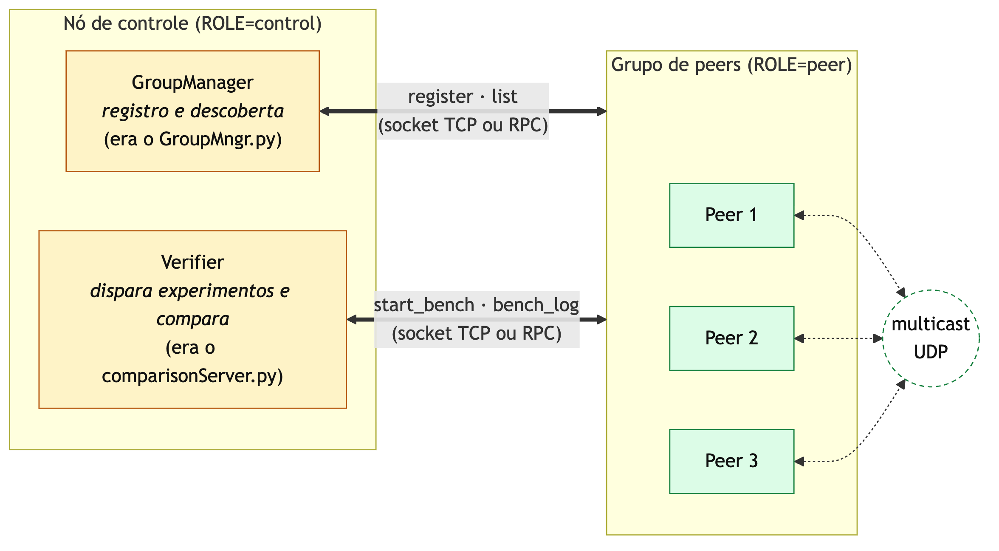
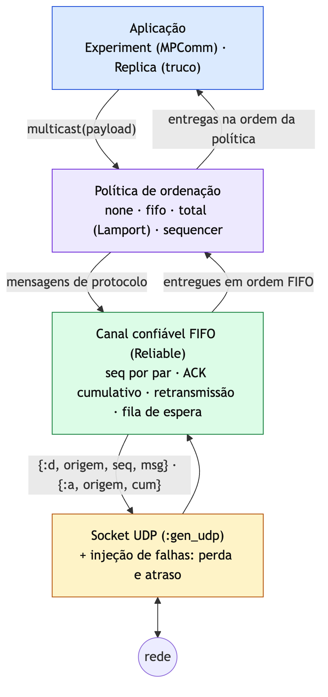

# Checkpoint 1 (05/11): como processos conversam

**Disciplinas:** Sistemas Operacionais e Sistemas Distribuídos (INF0344), UFG, 2026/2
**Grupo:** <nomes e matrículas>
**Código deste checkpoint:** tag `parte-1b` (Partes 1a e 1b do enunciado)

Cada tópico segue a mesma estrutura:

- **Teoria:** o conceito como é visto em aula (SO e SD);
- **Na implementação:** como o conceito aparece no código, com os arquivos;
- **No jogo:** qual papel ele tem no truco online.

---

## 1. Contexto: o que é o TrucoON

Primeira apresentação para a turma, então esta seção explica o projeto inteiro antes
de entrar nos tópicos.

- **O jogo:** truco mineiro online para partidas privadas (1x1 ou 2x2). Uma pessoa
  cria a mesa, manda o link ou o QR code para os amigos e eles jogam pelo navegador.
- **O ponto de partida:** o MPComm do Prof. Fábio M. Costa, em Python. Um grupo de
  processos troca mensagens por multicast e mostra que, sem coordenação, cada
  processo recebe as mensagens numa ordem diferente.
- **A ideia:** dar significado a essas mensagens. Cada processo (peer) é um
  **servidor de jogo** de uma "região" e guarda uma cópia de todas as mesas. Cada
  mensagem é uma **jogada**. Se as cópias aplicam as jogadas em ordens diferentes, o
  jogo fica inconsistente: dois jogadores na mesma cadeira, um truco aceito num
  servidor e rejeitado no outro.
- **Por que Elixir/Erlang:** a máquina virtual do Erlang (BEAM) foi feita para
  processos que só se comunicam por mensagens. É o mesmo modelo do trabalho, aplicado
  dentro de cada máquina e entre máquinas.
- **Os três checkpoints:**

| Checkpoint | Pergunta | Partes |
|---|---|---|
| 1 (05/11) | Como os processos conversam? | 1a (socket × RPC) e 1b (perda e FIFO) |
| 2 (19/11) | O que acontece com o jogo quando a ordem das mensagens varia? | 2 (truco replicado) |
| 3 (26/11) | Como fazer todos concordarem com a ordem? | 3 (Lamport) e 4 (sequenciador) |



## 2. Processos e troca de mensagens

**Teoria.**
- SO: processo, espaço de endereçamento, estados (pronto, executando, bloqueado),
  comunicação entre processos (IPC) por memória compartilhada ou por troca de mensagens.
- SD: num sistema distribuído não existe memória compartilhada; só existe troca de
  mensagens pela rede.

**Na implementação.**
- Cada peer é **um processo do SO** (`beam.smp`). Dentro dele, a BEAM roda processos
  leves, cada um com seu heap, que só se comunicam por `send`/`receive`.
- Um processo que espera uma mensagem fica bloqueado e não gasta CPU. O MPComm
  original fazia **espera ativa** (`while handShakeCount < N: pass`, 100% de um
  núcleo); o TrucoON usa timers (`Process.send_after`).
- Árvore de processos do peer: `lib/truco_on/peer.ex` (supervisor).

**No jogo.**
- Cada servidor de jogo é um processo do SO. No checkpoint 2, cada jogador conectado
  vira um processo leve, e a cópia das mesas, outro. O modelo de "processos que só
  trocam mensagens" vale dentro da máquina e entre as máquinas.

## 3. Modelo cliente-servidor com sockets TCP

**Teoria.**
- Socket como ponto de comunicação do SO: `socket`, `bind`, `listen`, `accept`,
  `connect`, `send`/`recv`. As chamadas de sistema passam pelos buffers do kernel.
- TCP é um fluxo de bytes: quem programa precisa delimitar as mensagens
  (enquadramento) e serializar os dados.
- E/S bloqueante × orientada a eventos.

**Na implementação.**
- `lib/truco_on/control/socket_server.ex`: `:gen_tcp.listen` com `packet: 4`
  (prefixo de 4 bytes com o tamanho) e `active: false` (o processo chama `recv` e
  bloqueia).
- Serialização com `:erlang.term_to_binary/1`, o equivalente do `pickle`. Na leitura,
  `binary_to_term(bin, [:safe])`: o `pickle.loads` do original permite executar
  código remoto.
- Correção em relação ao MPComm: `recv(2048)` podia truncar respostas grandes.

**No jogo.**
- O **nó de controle** (`GroupManager`) é o servidor onde os servidores de jogo se
  registram e descobrem os outros. Sem ele, um peer não sabe para quem mandar as
  jogadas.

## 4. RPC: chamada de procedimento remoto

**Teoria.**
- RPC esconde a rede atrás de uma chamada de função: stubs, empacotamento dos
  parâmetros (*marshalling*) e transparência de acesso (Tanenbaum & van Steen, cap. 4).
- Uma chamada remota pode falhar de formas que uma chamada local não falha: rede fora,
  servidor caído, timeout.

**Na implementação.**
- `lib/truco_on/control/client.ex`: o mesmo pedido sai por socket ou por RPC
  (`:erpc.call`), conforme a variável `CONTROL`.
- Os dois transportes chegam **na mesma função** `handle/2` no servidor, então a
  comparação é justa: só o transporte muda.
- Medição (`V.transport_benchmark(300)`): socket 143 µs × RPC 28 µs de média. O RPC
  ganha porque o Erlang mantém uma conexão TCP aberta entre os nós; o socket abre e
  fecha uma conexão por pedido, como o original.
- Vantagens e desvantagens: ver `docs/parte-1a-rpc.md`. Pontos principais: o RPC exige
  Erlang nos dois lados e dá acesso a qualquer função do nó remoto; o socket funciona
  com qualquer linguagem e expõe só o que `handle/2` aceita.


**No jogo.**
- O nó de controle usa RPC (ou socket) para comandar os servidores de jogo: iniciar
  experimentos, coletar logs, mudar a perda de pacotes em tempo real.
- O navegador do jogador não fala RPC do Erlang. Por isso o jogador usa HTTP e
  WebSocket (checkpoint 2). É o "acoplamento de plataforma" do RPC na prática.

## 5. Multicast sobre UDP: perda, atraso e reordenação

**Teoria.**
- UDP entrega datagramas sem garantia: podem se perder, chegar duplicados ou fora de
  ordem.
- Multicast em nível de aplicação: enviar a mesma mensagem para N processos com N
  envios.

**Na implementação.**
- `lib/truco_on/peer/multicast.ex`: envio com `:gen_udp.send/3` para cada peer;
  recepção em modo `active: true` (o datagrama vira uma mensagem na caixa do processo,
  parecido com uma interrupção).
- **Injeção de falhas** para simular regiões diferentes numa máquina só: `LOSS`
  (probabilidade de descarte) e `DELAY_MIN`/`DELAY_MAX` (atraso aleatório, que causa
  reordenação). Muda em tempo real com `V.faults/3`.
- `ORDERING=none` é o comportamento do MPComm original: entrega o que chegar, na ordem
  em que chegar.

**No jogo.**
- Cada jogada é enviada para todos os servidores. Uma jogada perdida deixa uma cópia
  das mesas desatualizada: o jogador ligado àquele servidor nunca vê a carta jogada.

## 6. Canal confiável e ordem FIFO

**Teoria.**
- Confiabilidade sobre um canal não confiável: número de sequência, confirmação (ACK),
  retransmissão por tempo esgotado.
- ACK cumulativo ("recebi tudo até n") e fila de espera (*hold-back queue*) para
  mensagens que chegam adiantadas.
- **Ordem FIFO:** as mensagens de um mesmo remetente são entregues na ordem em que ele
  enviou.

**Na implementação.**
- `lib/truco_on/multicast/reliable.ex`: estrutura de dados pura, sem rede, testada
  sozinha. Um canal por par (remetente → destinatário):
  - remetente: `seq` crescente, guarda o que não teve ACK e retransmite após 150 ms;
  - destinatário: `expected`, descarta duplicatas, guarda as adiantadas, entrega as
    contíguas e responde com ACK cumulativo.
- Formato dos datagramas: `{:d, origem, seq, msg}`, `{:a, origem, cum}`,
  `{:r, origem, msg}`.




**No jogo.**
- As jogadas de um mesmo jogador chegam na ordem certa em todos os servidores: se ele
  pede truco e depois joga uma carta, ninguém vê a carta antes do truco.

## 7. Resultados

4 peers, 30 mensagens cada, 10% de perda, 0–60 ms de atraso (`V.bench(30)`):

| `ORDERING` | Perdidas | Duplicadas | Violações FIFO | Posições fora de ordem |
|---|---|---|---|---|
| `none` (MPComm original) | 50 | 0 | 28 | 110 de 110 |
| `fifo` (Parte 1b) | **0** | **0** | **0** | 116 de 120 |

Custo do canal confiável: ~9,3 datagramas UDP por multicast (dados, ACKs e
retransmissões), contra 4 no modo sem tratamento.

## 8. Demonstração prática

```bash
CONTROL=socket ORDERING=none LOSS=0.1 DELAY_MAX=60 scripts/up.sh 4
scripts/run.sh 'V.bench(30)'                  # perdas e violações de FIFO
scripts/down.sh

CONTROL=rpc ORDERING=fifo LOSS=0.1 DELAY_MAX=60 scripts/up.sh 4
scripts/run.sh 'V.bench(30)'                  # 0 perdas, 0 violações
scripts/run.sh 'V.transport_benchmark(300)'   # socket × RPC
scripts/down.sh
```

Testes: `test/truco_on/multicast/protocols_test.exs` (rede simulada com 30% de perda)
e `test/truco_on/integration/group_test.exs`, blocos "Parte 1a" e "Parte 1b".

## 9. Conclusão e gancho para o checkpoint 2

O FIFO resolve perda e ordem **de cada remetente**, mas mensagens de remetentes
diferentes continuam chegando em ordens diferentes em cada servidor (116 de 120
posições fora de ordem). No checkpoint 2 essas mensagens passam a ser jogadas, e essa
diferença de ordem quebra o jogo.

## Referências

- A. S. Tanenbaum e M. van Steen, *Distributed Systems*, cap. 4 (Comunicação).
- A. S. Tanenbaum e H. Bos, *Sistemas Operacionais Modernos*, cap. 2 (Processos e
  threads, comunicação entre processos).
- MPComm: https://github.com/professorfabio/MPComm
- Documentos técnicos: `docs/parte-1a-rpc.md`, `docs/parte-1b-perda-fifo.md`.
