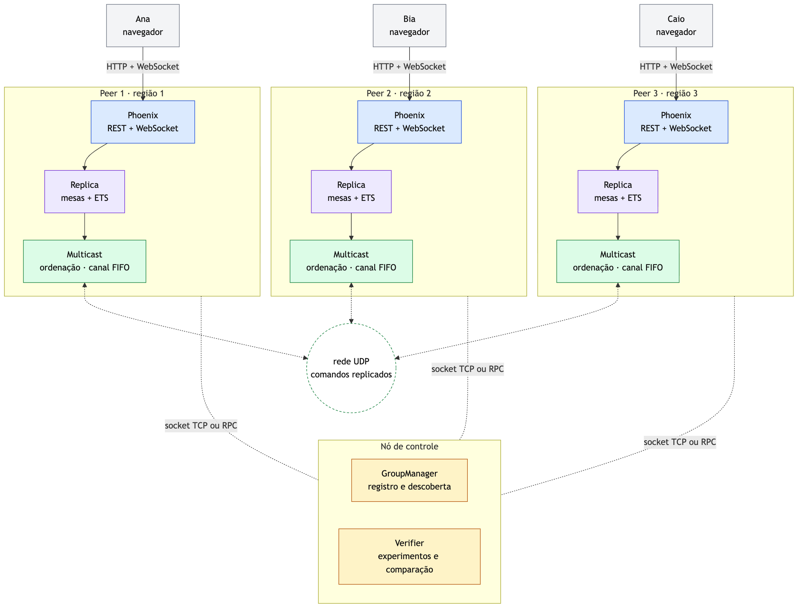
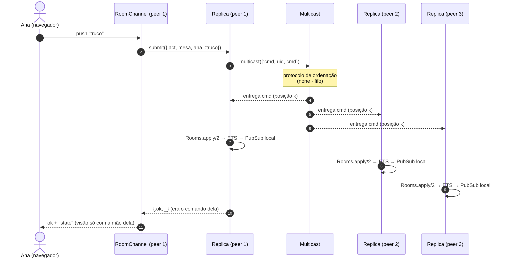
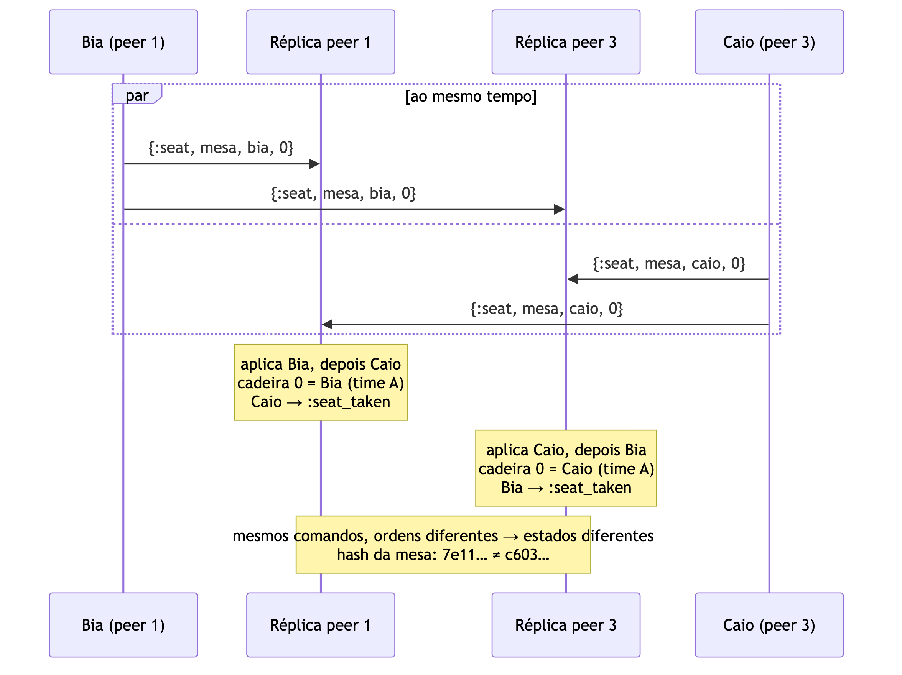
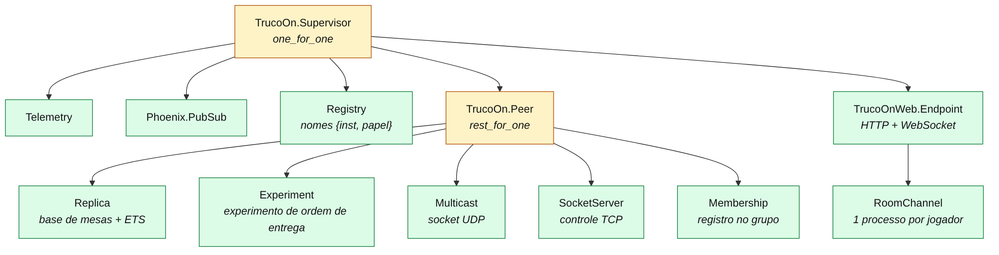

# Checkpoint 2 (19/11): o jogo replicado e por que a ordem importa

**Disciplinas:** Sistemas Operacionais e Sistemas Distribuídos (INF0344), UFG, 2026/2
**Equipe:** ZAP
**Participantes:**
- André de Oliveira Machado Filho (202406913)
- Alan Queiroz Dantas de Oliveira (202109882)
- Stephany Jorge Araújo Resque (202400316)
- Jamilly Vitorya da Silva Barbosa (202103736)

**Código deste checkpoint:** tag `parte-2`

Cada tópico segue a mesma estrutura:

- **Teoria:** o conceito como é visto em aula (SO e SD);
- **Na implementação:** como o conceito aparece no código, com os arquivos;
- **No jogo:** qual papel ele tem no truco online.

---

## 1. Onde paramos

No checkpoint 1, os processos trocam mensagens por UDP sem perder nenhuma e com as
mensagens de cada remetente em ordem (FIFO). Mas mensagens de remetentes diferentes
ainda chegam em ordens diferentes em cada processo. Agora as mensagens viram jogadas
de truco, e o efeito disso aparece no jogo.

## 2. A aplicação

- Truco mineiro para partidas privadas (1x1 ou 2x2): criar mesa, convidar por link ou
  QR code, escolher cadeira, jogar. Mobile-first, roda no navegador.
- Regras (baralho de 27 cartas, manilhas fixas, truco/seis/nove/doze, mão de 11, mão
  de ferro, partida até 12 tentos) escritas como **funções puras**:
  `lib/truco_on/truco/` (`deck.ex`, `evaluator.ex`, `rules.ex`, `game.ex`).
- Frontend em `app/` (Expo + React Native Web), servido por cada peer.



## 3. Replicação por máquina de estados

**Teoria.** [2, cap. 7]
- Replicar um serviço em vários processos para ficar perto dos usuários e tolerar
  falhas.
- Máquina de estados replicada: se todas as réplicas começam no mesmo estado e
  aplicam os **mesmos comandos na mesma ordem**, terminam no mesmo estado.

**Na implementação.**
- Cada mensagem multicast é um comando: `{:create, ...}`, `{:join, ...}`,
  `{:seat, ...}`, `{:start, ...}`, `{:act, ...}`, `{:leave, ...}`, `{:rematch, ...}`.
- `lib/truco_on/truco/rooms.ex`: `Rooms.apply/2` aplica um comando à base de mesas.
- `lib/truco_on/peer/replica.ex`: recebe os comandos na ordem entregue pelo multicast
  e aplica.
- Ponto central: o servidor **não aplica** a jogada do próprio jogador na hora. Ele
  manda para o grupo, espera a entrega pelo multicast como todo mundo, e só então
  responde.



**No jogo.**
- Cada servidor de jogo (uma "região") tem uma cópia completa de todas as mesas.
  Amigos ligados a servidores diferentes jogam na mesma mesa.

## 4. Determinismo

**Teoria.** [2, cap. 7]
- A replicação por máquina de estados só funciona se aplicar um comando der sempre o
  mesmo resultado. Relógio local, números aleatórios e timers quebram isso.

**Na implementação.**
- Embaralhamento com gerador pseudoaleatório de estado explícito
  (`:rand.seed_s/2`), com a semente enviada no comando `:create` (`truco/deck.ex`).
- Sem timers nem relógio: um servidor de jogo comum teria timeout de abandono e limite
  de requisições pelo relógio local, e cada réplica veria esse tempo esgotar num
  momento diferente. Aqui tudo que muda o estado é comando.
- Código da mesa sorteado por quem cria e enviado no comando. Se colidir, todas as
  réplicas rejeitam igual (`:code_taken`).

**No jogo.**
- Todas as réplicas distribuem **as mesmas cartas** para os mesmos jogadores.

## 5. Condição de corrida: por que a ordem é crítica

**Teoria.** [1, cap. 2], [2, cap. 7]
- SO: condição de corrida, quando o resultado depende da ordem em que processos
  concorrentes acessam um dado compartilhado; seção crítica.
- SD: o mesmo problema entre réplicas. Comandos concorrentes chegam em ordens
  diferentes e cada réplica decide de um jeito.

**Na implementação.**
- `Rooms.apply/2` é determinística, então a única fonte de diferença é a ordem.
- Medição com `S.seat_race(rooms: 8)` (`lib/truco_on/control/scenario.ex`), 4 peers:
  **8 de 8 mesas divergentes**, tanto em `none` quanto em `fifo`.
- Teste automático: `test/truco_on/integration/divergence_test.exs`.

**No jogo.** Três situações em que as réplicas divergem:
1. **Disputa de cadeira:** Bia e Caio pedem a cadeira 0 ao mesmo tempo, por servidores
   diferentes. Cada réplica dá a cadeira para quem chegou primeiro nela.
2. **Truco × carta:** Ana joga a carta que fecha a mão enquanto Duda pede truco. Numa
   réplica a mão vale 3; na outra, vale 1. O placar diverge.
3. **Aceito × fujo no 2x2:** os dois parceiros respondem ao truco ao mesmo tempo, com
   respostas diferentes.



## 6. Sincronização dentro do servidor: um único escritor

**Teoria.** [1, cap. 2], [3]
- SO: exclusão mútua (mutex, semáforo) e o problema dos **leitores e escritores**.

**Na implementação.**
- `Replica` é um GenServer: processa uma mensagem por vez da sua caixa de entrada.
  Por ser o **único escritor** da base de mesas, não precisa de lock.
- O estado é publicado numa tabela **ETS** com `read_concurrency: true`. Os processos
  dos jogadores leem dela sem entrar na fila da `Replica`: vários leitores, um escritor.
- As mensagens entre processos Erlang são copiadas, então não há memória
  compartilhada para disputar.

**No jogo.**
- Muitos jogadores olhando a mesa ao mesmo tempo não atrasam quem está jogando.

## 7. Processos, supervisão e tolerância a falhas

**Teoria.** [1, cap. 2], [4]
- SO: hierarquia de processos (pai e filho), término e tratamento de falhas.
- Erlang/OTP: processos isolados que podem falhar sozinhos ("deixe falhar") e
  supervisores que os reiniciam.

**Na implementação.**
- Árvore de supervisão OTP: `lib/truco_on/peer.ex` com estratégia `rest_for_one`. Se o
  multicast cai, os processos que dependem dele são reiniciados junto.
- Cada jogador conectado é um processo (`lib/truco_on_web/channels/room_channel.ex`).
  Se ele cai, morre sozinho e não afeta os outros.



**No jogo.**
- A conexão de um jogador caindo não derruba a mesa nem o servidor.

## 8. Com estado × sem estado

**Teoria.** [2, cap. 3]
- Servidores sem estado escalam e se recuperam fácil; servidores com estado guardam
  sessão e dados.

**Na implementação.**

| Camada | Tipo | Estado |
|---|---|---|
| REST (`/api/session`, `/api/rooms`) | sem estado | identidade num token assinado (HMAC) |
| WebSocket (`RoomChannel`) | com estado de sessão | um processo por jogador |
| `Replica` | com estado | único escritor da base de mesas |
| ETS | cache local | leitura concorrente |

**No jogo.**
- Jogador entra como convidado (apelido + token). O token vale em qualquer servidor,
  porque todos compartilham o segredo.
- Código de convite de 8 caracteres sem símbolos ambíguos (sem 0/O, 1/I/L), no link
  e no QR code (`truco/code.ex`).

## 9. Verificação das réplicas

**Na implementação.**
- Cada réplica expõe um **hash encadeado** da sequência de comandos (muda se a ordem
  mudar) e um hash por mesa.
- `V.replicas()` compara os hashes entre os peers.

**No jogo.**
- O painel **⚙ Réplicas** da interface mostra os hashes ao vivo: verde quando as
  cópias são iguais, vermelho quando divergiram.

## 10. Demonstração prática

```bash
scripts/build_web.sh
ORDERING=fifo DELAY_MAX=60 scripts/up.sh 3
```

1. Abrir `http://localhost:4001`, criar uma mesa 2x2 e abrir o painel ⚙ Réplicas.
2. Abrir o link de convite em abas anônimas, nas portas `:4002` e `:4003`, para cada
   jogador ficar num servidor diferente.
3. Todos tocam em "Sentar" ao mesmo tempo, ou `scripts/run.sh 'S.seat_race(rooms: 8)'`.
4. O painel fica vermelho: as réplicas divergiram.

## 11. Conclusão

- O jogo é uma máquina de estados replicada: regras puras e determinísticas, um único
  escritor por servidor, e o estado de cada réplica depende só da ordem dos comandos.
- Enquanto as jogadas não são concorrentes, as réplicas ficam iguais.
- Quando duas jogadas acontecem ao mesmo tempo em servidores diferentes, cada cópia
  decide de um jeito, e o FIFO não impede isso: 8 de 8 mesas divergem na disputa de
  cadeiras.

## Referências

- [1] TANENBAUM, A. S.; BOS, H. *Sistemas Operacionais Modernos*. 4. ed. Pearson, 2016.
- [2] VAN STEEN, M.; TANENBAUM, A. S. *Distributed Systems*. 4. ed. 2023 (distributed-systems.net).
- [3] STENMAN, E. *The BEAM Book: Understanding the Erlang Runtime System*. https://blog.stenmans.org/theBeamBook/
- [4] ARMSTRONG, J. *Making reliable distributed systems in the presence of software errors*. Tese (Doutorado), KTH, 2003.
