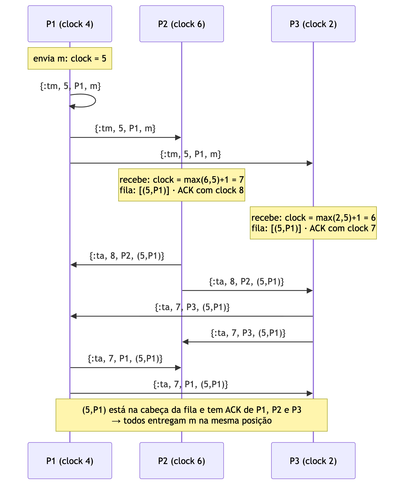

# Parte 3 — Coordenação por ordem total (relógios de Lamport)

## Objetivo

Garantir que **todas as réplicas apliquem os comandos na mesma ordem** e verificar que
isso mantém as mesas consistentes (Tanenbaum & van Steen, cap. 5, *totally ordered
multicasting*).

## Relógio de Lamport

Cada processo tem um contador inteiro `clock`:

- antes de enviar uma mensagem: `clock = clock + 1`, e a mensagem leva esse valor;
- ao receber uma mensagem com carimbo `t`: `clock = max(clock, t) + 1`.

Isso garante que, se o evento A pode ter causado B, então `L(A) < L(B)`. Desempatando
carimbos iguais pelo id do processo, `(ts, id)` define uma **ordem total** sobre todas
as mensagens, a mesma vista por todos.

## Protocolo (`lib/truco_on/multicast/ordering/lamport.ex`)

Premissa: canais **confiáveis e FIFO**, garantidos pela camada da Parte 1b.

1. **Enviar** `m`: `clock += 1`, manda `{:tm, clock, meu_id, m}` para todos, inclusive
   para si mesmo.
2. **Receber** `{:tm, ts, origem, m}`: atualiza o relógio, coloca `m` numa fila
   ordenada por `(ts, origem)` (`:gb_sets`) e manda um **ACK** carimbado
   `{:ta, clock, meu_id, (ts, origem)}` para todos.
3. **Receber ACK**: atualiza o relógio e anota quem confirmou. O ACK pode chegar
   **antes** da própria mensagem, porque vêm por canais diferentes, então ACKs de
   mensagens ainda desconhecidas também são guardados.
4. **Entregar**: enquanto a mensagem na **cabeça** da fila tiver ACK de **todos** os N
   processos, entrega à aplicação e remove.



### Por que funciona

Suponha que a cabeça `m = (ts, o)` tem ACK de todos e existe `m'` com carimbo menor
que ainda não chegou. `m'` foi enviada por algum processo `p`, que também confirmou
`m`:

- se `p` enviou `m'` **antes** do ACK de `m`, o canal FIFO de `p` entrega `m'` antes
  desse ACK, então `m'` já estaria na fila;
- se `p` enviou `m'` **depois**, o carimbo de `m'` é maior que o do ACK, que é maior que
  `ts`. Contradição.

Logo, quando a cabeça tem todos os ACKs, nenhuma mensagem menor pode aparecer depois:
todos entregam na mesma ordem.

## Verificação da eficácia

Duas formas, as duas automáticas:

**1. Experimento do MPComm** (`V.bench/1`): cada peer registra a ordem de entrega e o
Verifier compara posição por posição.

**2. Réplicas do truco** (`V.replicas/0`): compara o hash encadeado da sequência de
comandos e o hash do estado de cada mesa em todos os peers.

Resultados (4 peers, 10% de perda, 0–60 ms de atraso):

| | `fifo` (sem coordenação) | `total` (Lamport) |
|---|---|---|
| Posições fora de ordem (120 mensagens) | 116 | **0** |
| Mesas divergentes na disputa de cadeiras | 8 de 8 | **0 de 8** |
| Mesma ordem de comandos em todas as réplicas | não | **sim** |

Também verificado com partidas inteiras jogadas por bots (`S.games/1`), com uma
partida real jogada por dois navegadores em peers diferentes (hash da mesa idêntico
nos 3 peers) e em `test/truco_on/integration/group_test.exs` com 15% de perda.

## Custo

Por multicast com N processos: **N** mensagens de dados + **N × N** ACKs.

| | por multicast (N = 4) |
|---|---|
| Mensagens do protocolo | **20** (4 + 16), medido exatamente |
| Datagramas UDP (com ACKs do canal e retransmissões) | ~58 |
| Retransmissões no experimento | 1.274 |

Outro custo: **latência**. Uma mensagem só é entregue depois que chegam os ACKs de
todos, então a entrega espera pelo processo **mais lento** do grupo. Se um processo
cai, ninguém entrega mais nada (o protocolo não tolera falhas).

## Como demonstrar

```bash
ORDERING=total LOSS=0.1 DELAY_MAX=60 scripts/up.sh 4
scripts/run.sh 'V.bench(30)'                 # 0 rodadas fora de ordem
scripts/run.sh 'S.seat_race(rooms: 8)'       # 0 mesas divergentes
scripts/run.sh 'V.message_cost()'            # 20 mensagens por multicast
```

Na interface: repetir a disputa de cadeiras da Parte 2 com `ORDERING=total`. O painel
⚙ Réplicas fica verde, com o mesmo hash nos peers.

Testes: `protocols_test.exs` (rede simulada intercalando canais aleatoriamente, 20
rodadas × 4 processos) e `group_test.exs` (peers reais).
