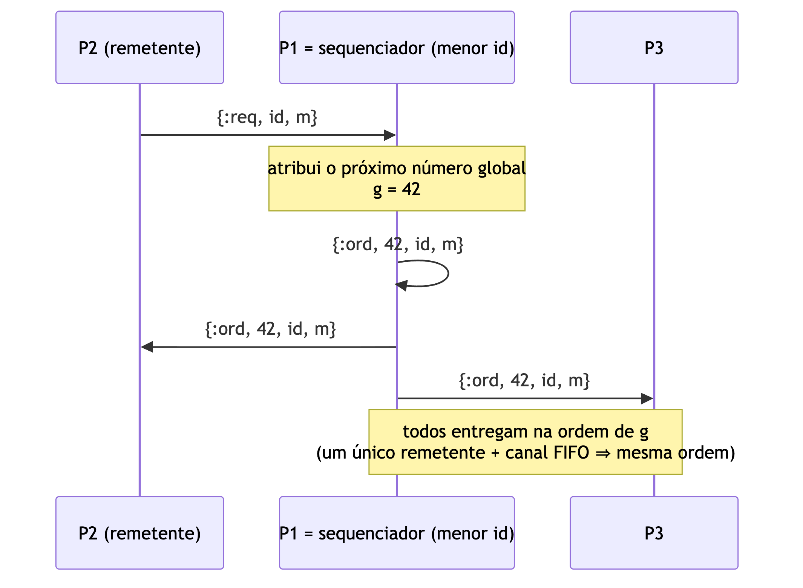
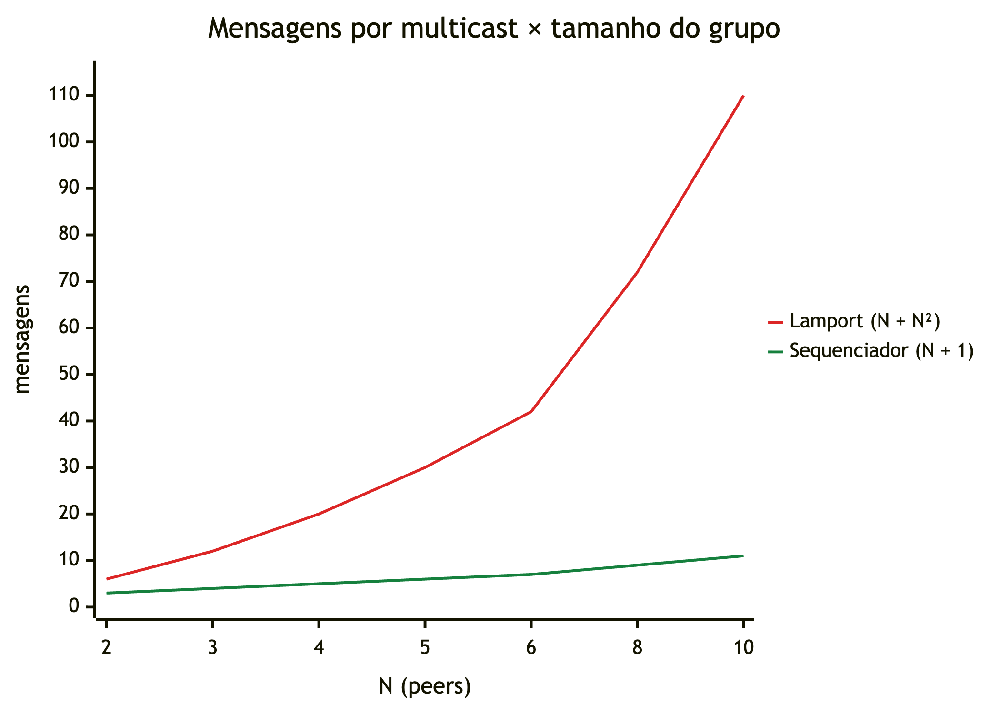

# Parte 4 — Coordenação mais leve: sequenciador (protocolo baseado em primário)

## Objetivo

Manter as réplicas consistentes, como na Parte 3, trocando **menos mensagens**
(cap. 7: protocolos de consistência baseados em primário).

## Ideia

O Lamport precisa de N² ACKs porque **ninguém sabe sozinho** qual é a ordem: cada
processo precisa ouvir todos os outros. Se **um processo decide a ordem**, os outros
só precisam seguir.

No TrucoON o processo de menor id do grupo é o **sequenciador**, o "primário" que
ordena as escritas na base replicada (*remote-write*):

1. Quem quer enviar `m` manda só para o sequenciador: `{:req, m}`. É **1 mensagem**,
   ou nenhuma se o remetente for o próprio sequenciador.
2. O sequenciador atribui o próximo número global `g` e manda `{:ord, g, m}` para
   todos: **N mensagens**.
3. Cada processo entrega em ordem crescente de `g`, com fila de espera para lacunas.



Como todas as mensagens `{:ord, ...}` saem de **um único remetente** por canais FIFO
confiáveis (Parte 1b), todos as recebem na mesma ordem. Isso é **ordem total** e dá
**consistência sequencial**: todas as réplicas veem as escritas na ordem escolhida
pelo primário.

Código: `lib/truco_on/multicast/ordering/sequencer.ex` (~80 linhas, puro).

## Comparação com a Parte 3

| | Lamport (Parte 3) | Sequenciador (Parte 4) |
|---|---|---|
| Mensagens de protocolo por multicast | N + N² | N + 1 (N se o remetente é o sequenciador) |
| N = 4, medido | **20** | **4,75** |
| Datagramas UDP por multicast (10% de perda) | ~58 | ~13 |
| Retransmissões no mesmo experimento | 1.274 | 266 |
| Posições fora de ordem | 0 | 0 |
| Mesas divergentes (disputa de cadeiras) | 0 de 8 | 0 de 8 |
| Quem precisa responder para entregar | **todos** os processos | só o sequenciador |
| Ponto único de falha | não, mas qualquer processo lento ou caído trava todos | **sim**: o sequenciador |
| Gargalo | não | sim: toda escrita passa por ele |



O crescimento é a diferença principal: com 10 peers, Lamport gasta 110 mensagens por
multicast e o sequenciador 11.

## Limitações e o que faltaria para produção

- **Falha do sequenciador**: se ele cai, ninguém mais ordena. A solução clássica é
  **eleger** outro (algoritmo do valentão ou em anel, cap. 5) e recuperar o último `g`
  (os peers sabem até onde receberam). Não foi implementado.
- **Gargalo**: um sequenciador por mesa (o peer do anfitrião, por exemplo) dividiria a
  carga. Basta trocar `Enum.min(ids)` por uma função do código da mesa, porque mesas
  diferentes não precisam de ordem entre si.
- **Latência assimétrica**: quem está longe do sequenciador paga dois trechos de rede
  (ida ao sequenciador e volta para todos); quem está perto paga quase nada.

## Como demonstrar

```bash
ORDERING=sequencer LOSS=0.1 DELAY_MAX=60 scripts/up.sh 4
scripts/run.sh 'V.bench(30)'                 # 0 fora de ordem
scripts/run.sh 'S.seat_race(rooms: 8)'       # 0 mesas divergentes
scripts/run.sh 'V.message_cost()'            # ~4,75 mensagens por multicast
scripts/down.sh

scripts/measure.sh 4 30                      # tabela comparando os 4 modos
```

`GET /api/info` mostra qual peer é o sequenciador (`"sequencer": 1`).

Testes: `protocols_test.exs` (custo exato N + 1 e ordem total em rede simulada) e
`group_test.exs` (custo entre 4 e 5 com peers reais; partidas com bots e réplicas
idênticas).
