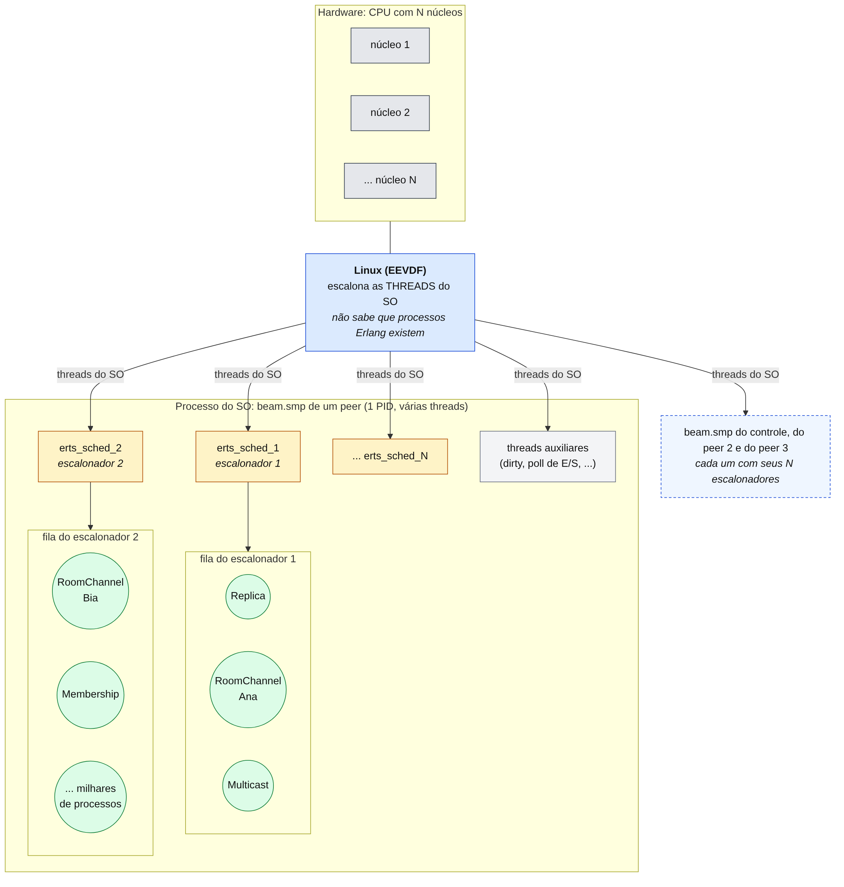
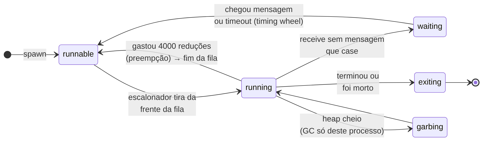
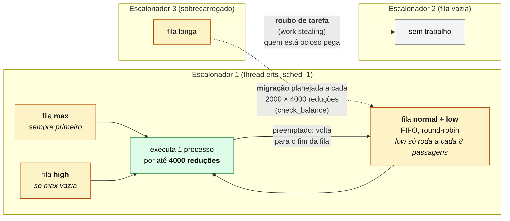
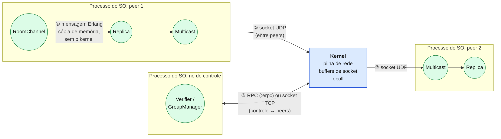

# TrucoON em Sistemas Operacionais

Material para o seminário de **Sistemas Operacionais (INF0336)**. O código é o mesmo
do trabalho de Sistemas Distribuídos; aqui olhamos para ele pelo lado do SO:
**processos, escalonamento e comunicação entre processos**, usando o que a máquina
virtual do Erlang (BEAM) já faz por baixo.

A ideia em uma frase:

> Cada peer do TrucoON é **um** processo do sistema operacional. Dentro dele, a BEAM
> roda **milhares de processos leves** e tem o **seu próprio escalonador**, com um
> escalonador por núcleo da CPU. O Linux não enxerga esses processos: ele só vê as
> threads da BEAM.

Os diagramas estão em `docs/so/diagramas/` (`.mmd` para editar, `.svg` e `.png` para
os slides).

## 1. Dois níveis de escalonamento



- **Nível do SO:** o Linux escalona as **threads** do processo `beam.smp`. A BEAM cria
  uma thread escalonadora (`erts_sched_N`) para cada núcleo da CPU, além de algumas
  threads auxiliares para E/S e trabalho pesado.
- **Nível da BEAM:** cada thread escalonadora tem uma **fila de processos Erlang** e
  decide sozinha qual deles roda. Isso acontece em espaço de usuário: trocar de
  processo Erlang **não passa pelo kernel**.

**Analogia:** cada escalonador é um professor atendendo uma fila de alunos (os
processos Erlang). O professor dá a cada aluno um tempo fixo de atenção e passa para o
próximo. Quem está esperando uma resposta sai da fila até a resposta chegar. Um
professor sem alunos pega alunos da fila de outro professor.

Um cuidado com a analogia: os processos **não são filhos** do escalonador. Eles
ficam numa fila e podem **migrar** de um escalonador para outro. Quem é pai de quem no
TrucoON é definido pela **árvore de supervisão** (ver
[diagramas/2-supervisao](../diagramas/2-supervisao.png)), não pelo escalonador.

## 2. Processo do SO × processo Erlang

| | Processo do SO (ex.: `beam.smp`) | Processo Erlang (ex.: `Replica`) |
|---|---|---|
| Quem cria e escalona | kernel | BEAM, em espaço de usuário |
| Memória | espaço de endereçamento próprio | heap e pilha próprios, de poucas centenas de palavras no início |
| Compartilha memória? | threads do mesmo processo compartilham | **não**: só troca mensagens |
| Custo de criar | alto (`fork`/`clone`, tabelas de página) | muito baixo: dá para ter milhões |
| Troca de contexto | entra no kernel | só troca ponteiros dentro da BEAM |
| Se travar | pode derrubar o programa inteiro | morre sozinho; o supervisor reinicia |

No TrucoON, cada jogador conectado é um processo Erlang (`RoomChannel`), cada réplica
é um processo (`Replica`) e o multicast UDP é outro (`Multicast`). Todos vivem dentro
do mesmo processo do SO.

## 3. O algoritmo do escalonador da BEAM

### Estados de um processo



São os mesmos estados vistos em aula (pronto, executando, bloqueado), com nomes
diferentes: **runnable**, **running** e **waiting**. Um processo fica em *waiting*
quando executa um `receive` e não há mensagem para ele. Volta a ser *runnable* quando
chega uma mensagem ou um timeout.

### Preemptivo, por reduções

O escalonador é **preemptivo**, mas não mede tempo de relógio: mede **reduções**.
Uma redução é, aproximadamente, uma chamada de função. Cada processo recebe uma
cota de **4000 reduções** (2000 antes do OTP 20). Quando a cota acaba, o processo
volta para o fim da fila e o próximo entra.

Como todo laço em Erlang é uma recursão (uma chamada de função), **nenhum processo
consegue segurar a CPU para sempre**. Um loop infinito num processo não trava os
outros.

Detalhe: por dentro, a BEAM é cooperativa. O código verifica a cota a cada chamada de
função e devolve o controle. Para quem programa em Erlang, porém, o efeito é de
preempção. A exceção são as funções nativas escritas em C (NIFs) que demoram muito.
Para isso existem os escalonadores *dirty*, threads separadas para trabalho pesado.

### Filas: round-robin com prioridades



Cada escalonador tem **filas de prontos por prioridade**:

| Prioridade | Regra |
|---|---|
| `max` | roda antes de todas (usada internamente pela BEAM) |
| `high` | roda se não houver `max` |
| `normal` | fila FIFO: tira da frente, devolve no fim (**round-robin**) |
| `low` | divide a fila com `normal`, mas só roda a cada 8 passagens |

Todos os processos do TrucoON usam `normal`, então na prática é **round-robin com
quantum de 4000 reduções**.

### Balanceamento entre núcleos

- **Roubo de tarefa (*work stealing*):** um escalonador com a fila vazia rouba
  processos da fila de outro.
- **Migração:** de tempos em tempos (a cada 2000 × 4000 reduções), os escalonadores
  comparam o tamanho das filas e movem processos das filas cheias para as vazias.

### Comparando com o Linux

| | Linux (EEVDF, desde o kernel 6.6) | BEAM |
|---|---|---|
| O que escalona | threads | processos Erlang |
| Fatia de tempo | tempo de CPU, com prazo virtual | 4000 reduções |
| Filas | uma por CPU | uma por escalonador (= por núcleo) |
| Balanceamento | migração entre CPUs | roubo de tarefa + migração |
| Preempção | interrupção de timer | contagem de reduções |

## 4. Estado e memória

- Cada processo tem **heap próprio** e **coleta de lixo própria**. O GC de um
  processo não pausa os outros.
- Mensagens são **copiadas** do heap de quem envia para o de quem recebe. Por isso
  não há condição de corrida em memória compartilhada.
- Exceções: binários grandes (mais de 64 bytes) ficam numa área compartilhada com
  contagem de referências, e tabelas **ETS** ficam fora dos heaps.
- No TrucoON, o estado das mesas fica **dentro do processo `Replica`** (o único que
  escreve) e é publicado numa tabela ETS para os jogadores lerem sem entrar na fila
  dele. É o problema dos **leitores e escritores** resolvido com um único escritor.

## 5. Comunicação: onde entra cada mecanismo



| # | Mecanismo | Entre quem | Nível |
|---|---|---|---|
| ① | **Mensagem Erlang** (`send`/`receive`) | processos Erlang do **mesmo** peer (ex.: `RoomChannel` → `Replica`) | dentro da BEAM, sem chamada de sistema |
| ② | **Socket UDP** (`:gen_udp`) | `Multicast` de um peer ↔ `Multicast` de outro | chamadas de sistema `sendto`/`recvfrom`, buffers do kernel |
| ③a | **RPC** (`:erpc`) | nó de controle ↔ peers (`CONTROL=rpc`) | distribuição Erlang: uma conexão TCP persistente entre os nós |
| ③b | **Socket TCP** (`:gen_tcp`) | nó de controle ↔ peers (`CONTROL=socket`) | uma conexão TCP por pedido, protocolo próprio |

Ponto para o seminário: **o RPC também é um socket por baixo**. A diferença é quem
cuida da conexão, da serialização e dos erros. No socket, é o nosso código. No RPC, é
o runtime, e a chamada remota fica parecida com uma chamada de função local. A
comparação completa, com medição, está em [parte-1a-rpc.md](../parte-1a-rpc.md).

Os sockets usam os dois modos de E/S vistos em aula:
- UDP em modo **ativo** (`active: true`): o datagrama chega como mensagem na caixa do
  processo, parecido com uma interrupção;
- TCP em modo **passivo** (`active: false`): o processo chama `recv` e bloqueia até
  chegar o dado.

## 6. Roteiro de demonstração

Sem mudar o código, só com os scripts do projeto:

```bash
ORDERING=total scripts/up.sh 3          # 1 controle + 3 peers = 4 processos beam.smp
pgrep -a beam.smp                       # o SO vê só 4 processos
ps -L -o tid,comm -p <PID de um peer>   # threads erts_sched_1..N, uma por núcleo
```

Abra `http://localhost:4001` e jogue uma partida, com jogadores em peers diferentes.

**Quantos processos o SO vê × quantos a BEAM tem:**

```bash
scripts/run.sh ':erpc.call(:"peer1@127.0.0.1", fn -> %{
  escalonadores: :erlang.system_info(:schedulers_online),
  processos_erlang: :erlang.system_info(:process_count),
  filas: :erlang.statistics(:run_queue_lengths)
} end)'
```

**Preempção ao vivo:** coloque 32 processos em loop infinito dentro do peer 1 e
continue jogando. O `top` mostra a CPU cheia, mas o jogo continua respondendo, porque
cada loop perde a vez a cada 4000 reduções.

```bash
scripts/run.sh ':erpc.call(:"peer1@127.0.0.1", fn ->
  for _ <- 1..32, do: spawn(fn -> Stream.repeatedly(fn -> :ok end) |> Stream.run() end)
  :ok end)'
# jogue em http://localhost:4001 e veja o top; depois:
scripts/down.sh
```

Para comparar: o MPComm original esperava os outros peers com
`while handShakeCount < N: pass`, uma **espera ativa** que ocupa 100% de um núcleo.
O TrucoON usa timers (`Process.send_after`): o processo fica em *waiting* e não gasta
CPU.

## 7. Ligação com o plano de ensino

| Semana | Tópico | Onde aparece |
|---|---|---|
| 3 | Processos | processo do SO × processo Erlang; estados; árvore de supervisão |
| 4 | Comunicação de processos | mensagens, sockets UDP/TCP, RPC |
| 5 | Threads | BEAM = 1 processo com 1 thread escalonadora por núcleo; modelo M:N |
| 6 | Escalonamento | round-robin preemptivo por reduções, prioridades, roubo de tarefa |
| 7 | Sincronização | `Replica` como único escritor; ETS leitores/escritores; espera ativa × bloqueio |
| 8–9 | Memória | heap por processo, GC por processo, cópia de mensagens |
| Ementa | Multiprocessadores | um escalonador por núcleo, balanceamento entre eles |

## Referências

- Erik Stenman, *The BEAM Book*: https://blog.stenmans.org/theBeamBook/ — cap. 3
  (Processos) e cap. 10 (Escalonamento: reduções, filas, balanceamento).
- Documentação do Erlang: `erlang:system_info/1`, `erlang:process_flag(priority, ...)`
  e as opções `+S` e `+sbt` do `erl`.
